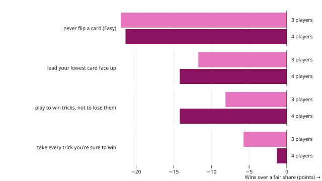
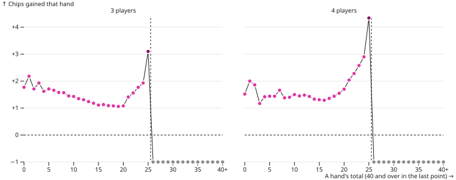
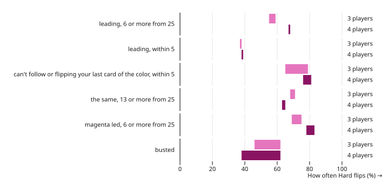
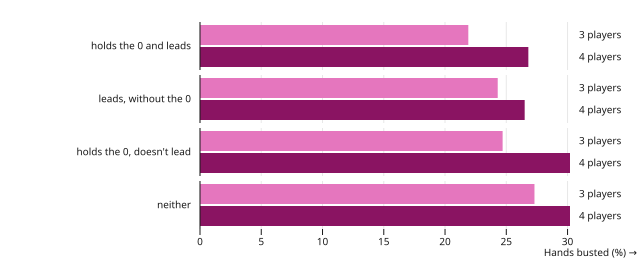

# Fives

Fives is a trick-taking card game for 3 or 4 players. Taiki Shinzawa designed Fives for CMYK's
Magenta line. You follow the led color if you can. Silver is trump. Whoever wins a trick keeps the card
they won it with. At the end of the hand, you want those winning cards to add up to 25, or as close
as you can get without going over. Every card's back is a magenta 5. So you can play any card face
down as one.

This is a strategy guide written by a simulator. It plays millions of games by the rules and
measures what wins: when to take a trick and when to let it go, what to do with high cards, and
when to flip a card to its magenta 5. Every piece of advice below comes with the numbers behind it.

You can play against its bots, or with friends, at [fives.visnup.com](https://fives.visnup.com).

The advice is only as good as the simulation. The simulation follows the How to Play booklet.
Where the booklet leaves a rule open, the appendix says how the simulator reads it. Nobody has
checked the simulator against real tables. Claude Opus 5.5 wrote the simulator and this guide in
Claude Code.

## The rules in a minute

The deck is 52 cards: 1 to 13 in blue, green and silver, and 0 to 4 and 6 to 13 in magenta. At 3
players the 10s to 13s come out. Everyone gets 12 cards at 3 players and 13 at 4.

- Whoever holds the magenta 0 leads the first trick of each hand, with any card. Whoever wins a
  trick leads the next.
- Follow the led color if you can. The highest silver wins, or else the highest of the led color.
- You can play any card face down as a magenta 5. Only one card a trick can be face down. You can
  flip only when you lead, when someone leads magenta (even if you hold magenta), when you can't follow,
  or when your last card of the led color is the one you flip.
- Your total is the sum of the cards you won tricks with. A face-down card counts 5. Closest to 25
  without going over takes 3 chips at 4 players (2 at 3), second 2 (1) and third 1. Exactly 25
  earns one more. A player who goes over, or busts, gives one of their chips to the closest player.
  When two or more players tie for closest, the bust's chip goes to a pot instead. The next hand's
  closest player takes the pot. A pot left after the 4th hand goes to no one.
- Everyone starts with 5 chips. After 4 hands, the most chips wins. On a tie, the player closest
  to 25 in the last hand wins. If that's tied too, they share the win.

## Reading the numbers

Almost every number here is a **win rate**: the share of games a player wins, out of thousands of
games from different deals.

- **A fair share** is what you'd win if everyone were equally good: 1 in 3 games (33.3%) at 3
  players and 1 in 4 (25%) at 4. The charts draw it as a dashed line.
- **Points** are percentage points of win rate. A player who wins 30% of games at a 4-player table
  is 5 points over a fair share.
- **The noise.** Any number from a limited number of games is a little off by luck. At 40,000
  games it's within about half a point; at 10,000, one point; at 2,000, about two. A difference
  smaller than that isn't a finding.
- **The bots** are the ones you can play online. **Easy** never plays a card face down. **Medium**
  plays only the three rules in the cheat sheet below. **Hard** is a model trained on millions of
  games. Hard is the strongest player here. The appendix describes how Hard learned.
- **What a rule is worth** is how much less than a fair share one player wins by breaking the rule
  at a table of Medium bots.

The simulator measures situations, like what a hand looks like or how often to flip, in games among
Hard bots. Hard's games are what good play looks like. The simulator measures what a rule is worth
against Medium.

## How to play well

The cheat sheet:

1. **When you lead and you're 5 or more from 25, lead face down.** If you hold magenta but none
   under 5, flip your highest magenta. Otherwise flip your highest silver. With neither, flip your
   highest card. Within 5 of 25, lead your lowest card. Flip it too if it's over 5.
2. **Otherwise, play the biggest card that loses the trick.** Play it face down if you're allowed to
   flip it. Don't try to win tricks: they'll come to you.
3. **If every card you have would win, play the biggest that leaves you 5 to go.** If none does,
   play the biggest that doesn't bust you. If they all bust, play the smallest.

**Try it:** [practice each rule](https://fives.visnup.com/learn/cheat-sheet) on
[puzzles from Hard's games](https://fives.visnup.com/learn/puzzles). Find the best play. Then see
every option's chance of winning.

One player breaking a rule at a table of Medium bots (40,000 games each):

| without this rule | 3 players | 4 players |
| --- | --- | --- |
| nothing missing (the default) | 32.9% | 24.8% |
| never flip a card (Easy) | 8.9% | 2.8% |
| lead your lowest card face up | 20.6% | 9.0% |
| play to win tricks, not to lose them | 16.8% | 9.4% |
| within 5 of 25, lead a card over 5 face up | 32.5% | 23.2% |
| take every trick you're sure to win | 28.0% | 20.2% |

A player who never flips wins about a quarter of a fair share at 3 players and a ninth at 4. The
obvious lead is your lowest card face up. Leading that way costs 12 and 16 points. Playing to win
tricks with your biggest card that doesn't bust costs 16 and 15. Flipping a lead over 5 near 25 is
worth less: 1.6 points at 4 players. At 3 players it's within the noise. The last row is the
surprise. Medium used to play this way: take a trick whenever nobody can beat your card and it
doesn't bust you. That costs 4.9 points at 3 players and 4.6 at 4. A trick you didn't have to take only adds to your total.
Plenty of tricks come to you anyway.

### What a hand looks like

How often a hand ends on each total, among Hard bots (10,000 games a player count):

Exactly 25 is the most common total of all: 16% of hands at 3 players and 14% at 4. Busting is
common too: 26% and 29% of hands go over. Few end under 15: 6% and 3%. So the game is about
getting rid of points. The points you can't get rid of should land you on 25.

And what each total earns that hand, on average:

From 20 to 24, each point is worth about a fifth of a chip at 3 players and a third at 4. 25 earns
over a chip more than 24. A bust always costs a chip. A low total isn't a disaster: at 3 players, a
total under 13 still earns more than 15 to 19. When you end that low, other players usually bust.
Their chips go to the closest player.

The table

| a hand's total | 3 players, hands | 3 players, chips | 4 players, hands | 4 players, chips |
| --- | --- | --- | --- | --- |
| 0 | 0.2% | 1.77 | 0.1% | 1.52 |
| 1 | 0.0% | 2.18 | 0.0% | 2.00 |
| 2 | 0.0% | 1.71 | 0.0% | 1.86 |
| 3 | 0.0% | 1.93 | 0.0% | 1.17 |
| 4 | 0.1% | 1.62 | 0.0% | 1.42 |
| 5 | 0.2% | 1.71 | 0.0% | 1.44 |
| 6 | 0.2% | 1.66 | 0.1% | 1.44 |
| 7 | 0.3% | 1.58 | 0.1% | 1.66 |
| 8 | 0.4% | 1.57 | 0.1% | 1.38 |
| 9 | 0.5% | 1.45 | 0.2% | 1.40 |
| 10 | 0.4% | 1.43 | 0.3% | 1.50 |
| 11 | 0.5% | 1.35 | 0.4% | 1.45 |
| 12 | 0.7% | 1.31 | 0.5% | 1.48 |
| 13 | 1.1% | 1.24 | 0.8% | 1.43 |
| 14 | 1.6% | 1.18 | 0.7% | 1.33 |
| 15 | 2.1% | 1.11 | 1.2% | 1.31 |
| 16 | 1.6% | 1.13 | 1.8% | 1.29 |
| 17 | 2.3% | 1.09 | 2.8% | 1.36 |
| 18 | 2.9% | 1.08 | 4.2% | 1.44 |
| 19 | 3.7% | 1.06 | 5.6% | 1.55 |
| 20 | 6.6% | 1.08 | 7.8% | 1.70 |
| 21 | 6.4% | 1.41 | 6.2% | 2.04 |
| 22 | 8.1% | 1.56 | 6.9% | 2.28 |
| 23 | 8.7% | 1.77 | 7.8% | 2.58 |
| 24 | 9.3% | 1.93 | 9.0% | 2.90 |
| 25 | 16.0% | 3.10 | 14.4% | 4.34 |
| 26 (bust) | 3.0% | −1.00 | 2.2% | −1.00 |
| 27 (bust) | 3.2% | −1.00 | 2.1% | −1.00 |
| 28 (bust) | 2.8% | −1.00 | 2.3% | −1.00 |
| 29 (bust) | 2.7% | −1.00 | 2.5% | −1.00 |
| 30 (bust) | 4.2% | −1.00 | 3.3% | −1.00 |
| 31 (bust) | 1.7% | −1.00 | 1.6% | −1.00 |
| 32 (bust) | 1.4% | −1.00 | 1.5% | −1.00 |
| 33 (bust) | 1.2% | −1.00 | 1.4% | −1.00 |
| 34 (bust) | 1.0% | −1.00 | 1.3% | −1.00 |
| 35 (bust) | 1.0% | −1.00 | 1.2% | −1.00 |
| 36 (bust) | 0.7% | −1.00 | 1.1% | −1.00 |
| 37 (bust) | 0.6% | −1.00 | 0.9% | −1.00 |
| 38 (bust) | 0.6% | −1.00 | 0.8% | −1.00 |
| 39 (bust) | 0.4% | −1.00 | 0.8% | −1.00 |
| 40+ (bust) | 1.7% | −1.00 | 5.9% | −1.00 |

**Try it:** [guess which total earns more](https://fives.visnup.com/learn/totals) at 3 and 4
players.

### Your magenta 5 is how you get rid of high cards

A card you play face down counts 5 if it wins, whatever it is face up. So flipping is the cheapest way
to shed a 12 or 13 that would otherwise win a trick and blow your total. A player who never flips
wins 8.9% at 3 players and 2.8% at 4.

How often Hard flips when it's allowed to and has a choice (8,000 games):

| when | flips, 3 players | flips, 4 players | what it flips |
| --- | --- | --- | --- |
| leading, 6 or more from 25 | 55–59% | 67–68% | a high card, silver about half the time |
| leading, within 5 | 37% | 38% | |
| can't follow or flipping your last card of the color, within 5 | 65–79% | 76–81% | its highest card, 5 times in 6 when it can't follow |
| the same, 13 or more from 25 | 68–71% | 63–65% | often a silver, rarely its highest |
| magenta led, 6 or more from 25 | 69–75% | 78–83% | |
| busted | 46–62% | 38–62% | |

Where a row gives a range, it's the range over the four hands of a game. Leading is two thirds of
the chances to flip. Close to 25, flip your biggest card when you can't follow: a face-down card
counts 5 if it wins. That makes flipping the safest way to shed a big card. Far from 25, flip a
silver you'd rather not win a trick with.

Hard flips less often than Medium. Medium flips every time in most of these rows. But none of
Hard's habits made a better rule for Medium (40,000 games each):

- Leading face down only a card over 5 loses 8 points at 3 players.
- Dumping face up once you've busted changes nothing.
- Flipping your highest card when someone leads magenta gains under a point.

### Lead face down: a lone high magenta, then silver

When you lead with 5 or more to go, flip a card. If you hold magenta and none of it is under 5,
flip your highest magenta. Otherwise flip your highest silver. With neither, flip your highest
card. Leading face down is the most valuable rule in the game: a player who leads their lowest card
face up instead wins 20.6% and 9.0%.

Why silver? A high silver is the card most likely to win a trick you didn't want. A silver that
wins adds its whole value to your total. Lead a silver face down and it counts 5 at most. Preferring
silver gained 8 points at 3 players and 11 at 4 over just leading your highest card.

Why a high magenta before that? Everyone leads face down. So someone leads magenta all the time. A face-down
card is a magenta 5, and you must follow it with magenta if you have any. Holding only magenta over
5, you must take that trick with a 6 to 13. Keep one magenta under 5 and you can duck under every
magenta 5. Without one, flip your highest magenta while you have the lead. This rule came from
playing the bots: a lone magenta 13 took a led magenta 5 and busted the hand. Flipping it first
gained 10.7 points at 3 players and 5.5 at 4 against Medium (40,000 games), 3.9 and 2.2 against
every earlier Medium, and 1.4 and −0.2 against Hard (10,000 games).

Within 5 of 25, a face-down 5 could bust you. So lead your lowest card instead. If that card is over
5, flip it anyway. Face up, a high silver is sure to take the trick. Face down, the card counts 5 at
most. Anyone with a higher magenta can take a magenta 5. Flipping gains 0.8 points at 4 players
(200,000 games). At 3 players the gain is within the noise. This rule came from people's games
online: at the last lead of a hand, flipping a silver 8, 9 or 12 would have won 8 to 74 points
more often than leading it face up.

### Don't chase tricks; duck them

When you follow, play the biggest card that still loses the trick. Ducking is how you shed high
cards when you can't flip them. The tricks you need come to you anyway: with everyone ducking,
someone still has to win each trick.

That goes for tricks you're sure to win, too. Medium used to take any trick nobody could beat if
taking it didn't bust. A trick that made exactly 25 came first. At 3 players, dropping that gained
4.2 points against Medium, 4.4 against every earlier Medium and 3.1 against Hard. At 4 players it
gained nothing against Medium or Hard. Taking a sure 25 on purpose was worth nothing at either
count: the cards that make 25 find you without it.

Ducking does mean busting more at 3 players. Medium now busts 28% of hands at 3 players and 32% at
4. When Medium took sure tricks, it busted 25% and 38%. Medium now hits 25 in 5% and 6.5% of hands.
Medium used to hit 25 in 9% and 6% (100,000 games). The two rules from playing the bots, flipping a
lone high magenta first and leaving 5 when forced to take, cut Medium's busts from 33% and 41%. Medium wins more anyway: a bust costs only one chip. Keeping your high cards out
of tricks pays more often than that.

### When you must take, leave room

Sometimes every card you're allowed to play wins the trick. Then take with the biggest card that
still leaves you 5 to go. Only if none does, take with the biggest that doesn't bust you. A player
who ducks every trick still has to take tricks. Those tricks come late in the hand. Every silver and
every top card of a color you hold is a trick you may have to win. Room you keep now pays for
them. This rule came from playing the bots: twice in one game, a Medium bot took with its biggest
card to 21 or 22, then busted on the next forced take. Leaving 5 gained 2.8 points at 4 players
against Medium (40,000 games), 6.4 against every earlier Medium and 0.9 against Hard (10,000). At 3
players it gains nothing beyond the noise. Leaving 3 or 7 gained less.

### Who leads the first trick

Whoever holds the magenta 0 leads each hand's first trick. To tell the lead and the card apart, the
simulator also plays games where a random other seat leads instead (`scripts/leads.ts`). Among Hard
bots (10,000 games each way):

| who | busts, 3 players | chips a hand, 3 players | busts, 4 players | chips a hand, 4 players |
| --- | --- | --- | --- | --- |
| holds the 0 and leads | 21.9% | 1.17 | 26.8% | 1.57 |
| leads, without the 0 | 24.3% | 1.12 | 26.5% | 1.58 |
| holds the 0, doesn't lead | 24.7% | 1.08 | 30.2% | 1.44 |
| neither | 27.3% | 1.03 | 30.2% | 1.46 |

At 4 players, the lead is what helps: the leader busts 4 points less often, with or without the 0.
The leader also gains an eighth of a chip more a hand. The 0 is worth only the lead it gives you.
The 0 as just another value card is worth nothing: in games where someone else leads, holding it
does no better than not holding it. Leading picks the color. Leading also lets you flip a high card
before anyone has won a trick. At 3 players both help a little and add up: either alone cuts busts
by about 3 points, both by 5.

### Playing to the chips

Your chance to win from where the chips stand after a hand, by how far ahead you are of the next
best player (Hard bots, 10,000 games a player count; blank where under 500 cases):

| chips ahead of the next best | 3 players, 3 hands left | 3 players, 2 hands left | 3 players, 1 hand left | 4 players, 3 hands left | 4 players, 2 hands left | 4 players, 1 hand left |
| --- | --- | --- | --- | --- | --- | --- |
| −4 or more | 13% | 9% | 2% | 10% | 8% | 3% |
| −3 | 20% | 18% | 16% | 19% | 17% | 20% |
| −2 | 27% | 25% | 32% | 24% | 22% | 28% |
| −1 | 31% | 33% | 40% | 25% | 28% | 37% |
| 0 | 38% | 42% | 42% | 32% | 38% | 39% |
| +1 | 45% | 50% | 46% | 38% | 46% | 42% |
| +2 | 56% | 59% | 56% | 45% | 52% | 53% |
| +3 | 66% | 66% | 78% | 55% | 59% | 65% |
| +4 |  | 75% | 88% |  | 66% | 82% |
| +5 |  | 84% | 98% |  | 73% | 89% |
| +6 or more |  | 90% | 100% |  | 84% | 97% |

A hand moves a lot of chips: 25 alone is worth 3 or 4. Every bust moves one more. So with two or
three hands left, a chip is worth only 5 to 10 points of win chance. In the last hand a chip is
worth up to 20: 4 ahead with one hand to go wins 82–88% of the time. 4 or more behind wins 2–3%. A tie
for the lead wins about 40%. That beats a fair share: only the leaders can win. But one chip
ahead with a hand to go is worth only 3 or 4 points over a tie: a single hand swings more than that.

### What Hard knows that the rules don't

Hard wins 56.0% of games at 3 players and 44.6% at 4 against a table of Medium bots (20,000 games).
So there's more to good play than three rules. Most of the difference is which card. Against
Medium as it was when it still took sure tricks, Hard picked a different play in 59% of its
decisions. In half of those, Hard makes the same kind of play with another card: ducking or
taking, face up or down. Hard ducks with a lower card than Medium's biggest 87% of the time. Hard
keeps its high cards for later. Hard counts cards. So Hard likely knows when a high card is safe to
hold.

None of that makes a simple rule. Ducking with your lowest losing card instead costs 15 to 17
points. Ducking with your biggest but keeping your very highest costs 2 to 4. Which card to keep
depends on more than a rule of thumb can see.

## How the bots compare

One player against Medium in every other seat (40,000 games; 20,000 for Hard):

| player | 3 players (fair 33.3%) | 4 players (fair 25.0%) |
| --- | --- | --- |
| Hard | 56.0% | 44.6% |
| the old Medium, which took sure tricks | 22.7% | 16.4% |
| Easy: never flips | 8.9% | 2.8% |
| random | 0.9% | 0.4% |
| greedy: takes the lead whenever it doesn't bust | 0.2% | 0.0% |

The chart shows each as a multiple of a fair share. Hard wins 1.7 times its share at 3 players and
1.8 at 4. Before the two rules from playing the bots, Hard won 64.0% and 54.6%. Those rules closed
about 30% of the gap. Easy wins about a quarter of its share at 3 players and a ninth at 4. Seats don't matter: in games among Medium bots, every seat wins
within half a point of a fair share (100,000 games).

## Appendix: under the hood

### The engine and how it reads the rules

`src/game.ts` deals and plays a game by the How to Play booklet. `src/game.test.ts` checks the
booklet's rules and its scoring example. Where the booklet leaves a rule open:

- Players tied for a place all take the lowest of the places they tie for, as the booklet says.
  The simulator reads that as holding for first place too. That reading decides 10% of hands' chips at 3 players and 14% at 4. Taking
  the higher place instead moves no player's wins beyond the noise (`scripts/rules.ts`, 20,000
  games).
- A bust with no chips gives nothing. When everyone busts, the chips go to a pot for the next
  hand's closest. A pot no one wins in the last hand goes to nobody.
- Chips are unlimited. The box's 42 never run out in practice.

A game among Medium bots takes about 0.1 ms. A game among Hard bots takes 26 ms.

### The players

- **Medium** (`defaultPolicy`) is a list of named rules, `STEPS` in `src/game.ts`. Medium tries
  them in order: `leadDown`, `duck`, then `least`.
- **Playouts** try every legal play: copy the game, deal the cards you can't see again at random
  (respecting colors someone has shown they're out of), play on with a fixed player in every seat,
  and make the play that wins most. Playing only to the end of the hand is cheaper and stronger
  than playing all four hands out. Playouts score the hand's end with `chance`: the win chance from the
  chips, a softmax over players fit by `scripts/chance.ts`.
- **Hard** (`src/learned.ts`) scores each legal play with a learned model and makes the best.

### Where each rule came from

Each rule started where Hard's choices differ from Medium's (`scripts/overrules.ts`), where
playouts prefer another play (`scripts/decisions.ts`) or where a person's game showed one. A rule then became a variant in
`scripts/variants.ts`. Medium kept a rule only if it beat Medium beyond the noise. The rule also had
to beat a table of every earlier Medium (the league). Rules cycle: a rule that beats one Medium
can lose to the next.

| rule | against Medium | against earlier Mediums | against Hard |
| --- | --- | --- | --- |
| lead your highest card face down, 5+ from 25 (Medium used to lead its lowest face up) | +31.8, +24.7 | | +6.2, +2.7 |
| flip your highest silver first | +8.3, +11.3 | +5.8, +6.6 | +1.9, +0.9 |
| before silver, flip your highest magenta when none is under 5, from playing the bots | +10.7, +5.5 | +3.9, +2.2 | +1.4, −0.2 |
| when every card wins, take with the biggest that leaves 5 to go, from playing the bots | +0.2, +2.8 | +0.6, +6.4 | +0.2, +0.9 |
| at 4 players, last to play early, take only within 12 of 25 (since dropped) | +3.5 at 4 players | +4.3 | +0.8 |
| don't take sure tricks, nor a sure 25, nor dump once busted | +4.2, −0.4 | +4.4, +1.8 | +3.1, 0.0 |
| within 5 of 25, lead a card over 5 face down, from people's games | +0.2, +0.8 | +0.3, +1.1 | +0.1, +0.1 |

The first number is at 3 players, the second at 4 (40,000 games against Medium, 200,000 for the
last row, 10,000 to 40,000 against the rest). The last row came from writing this guide: dropping each rule to measure its
worth found that taking sure tricks cost points.

What lost (2,000 games each, or 40,000 where close): leading the lowest card face down, or the
highest face up; 3, 7 or 10 to go as the cutoff for leading face down; flipping the lowest silver;
keeping your last silver to trump a late run of magenta 5s; when every card takes the trick,
avoiding a total of 23 or 24 with more than 3 or 6 cards left; ducking by flipping your highest
silver; not leading face down once everyone else is out of magenta; and six rules from Medium's
costliest decisions in playouts (`scripts/costly.ts`): taking a sure trick when last to play,
flipping a high silver when leading within 5 of 25, keeping or leading the card that makes exactly
25, leading your last card face down unless it fits, and taking with a silver you'd flip to duck.
Leading your last card face down gained 1.1 points at 4 players against Medium but lost 1.4 at 3
against Hard;
ducking with your lowest losing card when last early in a hand; taking with your highest card of
the led color when second to play early; taking sure tricks only within 6 to 16 of 25, or only in
a hand's last 4 or 8 cards; and six rules from shallow decision trees fit to Hard's choices
(`scripts/distill.ts`, `distill.py`).

### The learned model

Hard is a gradient-boosted tree model (LightGBM). Hard scores each legal play by its expected win
chance. Hard makes the play it scores highest.

- **Features** (`board` and `move` in `src/learned.ts`, version 2). About 90 numbers describe the
  situation: the hand and trick position, every player's total and distance from 25, chips and
  the pot, the led color and the card taking the trick, the counts and highest and lowest card of
  each color in hand, the highest unseen card of each color, and the colors each opponent has
  shown they're out of. Version 2 added card counting: each color's unseen cards and their two
  highest, the cards in hand nothing unseen beats, and who's still to play and what they're out
  of. About 20 more describe the play: its color, face and face-down value, whether it takes the
  trick for now and whether it's sure to, where it leaves the total, how many unseen cards beat it
  and how many players still to play could, and last, whether it's Medium's pick.
- **Labels.** The labels cover every decision of a round's games. Hand playouts value each legal
  play on 16 deals of the hidden cards, two hands deep, with the last round's small model in every
  seat. `chance` scores the end.
- **Fit** (`scripts/learn.py`): least-squares regression on the playout value, 1,500 trees of 127
  leaves, a learning rate of 0.1, at least 200 decisions a leaf. The fit stops early on held-out
  shards.
- **Rounds** (`scripts/round.sh`, one command a round, after a smoke test of itself): play 4,000
  to 12,000 games a player count with the last round's model, label them, fit a new model to the
  last few rounds' data, compare it against the last three models and Medium, and fit a small
  version. The small version is 50 trees of 31 leaves. The small version plays inside the next
  round's playouts at about 8 times Medium's cost. The full model costs 200 times Medium's.
  `scripts/status.ts` serves a round's progress.
- **Serving.** `kit/trees.ts` flattens the trees into typed arrays. `scoreAll` scores all of a
  decision's plays at once, walking each tree's situation-only branches once. `kit/pack.ts`
  packs the model as base64 into `src/packed/model.ts`. Convex bundles that file for the online
  game. The end-of-game review plays out every option at your decisions in a web worker per core.
  The review's Hard seats use the small model.

Each round's model at a table of the one before it (20,000 games, 10,000 from round 5; round 0's
against Medium, 4,000):

| round | 3 players | 4 players |
| --- | --- | --- |
| 1 | 47.5% | 38.6% |
| 2 | 42.2% | 39.9% |
| 3 | 37.1% | 27.5% |
| 4 | 35.3% | 26.5% |
| 5 | 34.8% | 25.2% |
| 6 | 34.7% | 24.9% |
| 7 | 33.5% | 26.0% |
| 8 | 33.5% | 25.8% |
| 8, refit with 1,500 trees of 127 leaves | 35.1% | 25.5% |
| 9 | 33.7% | 25.9% |
| 10, on its own games | 29.8% | 23.7% |
| 10, refit on rounds 7–10 | 32.8% | 24.8% |
| 11, 64 deals a label, one hand, against round 9 | 31.7% | 24.6% |

And against Medium as it was before it led face down:

| round, against the default | 3 players | 4 players |
| --- | --- | --- |
| 0 | 87.0% | 79.6% |
| 1 | 79.6% | 78.0% |
| 2 | 82.8% | 84.7% |
| 3 | 84.6% | 85.3% |
| 4 | 87.1% | 86.2% |
| 5 | 88.2% | 86.7% |
| 6 | 88.9% | 86.8% |
| 7 | 89.4% | 86.4% |
| 8 | 89.5% | 87.4% |
| 9 | 91.0% | 88.6% |

Round 0 learned from Medium's games with Medium inside the playouts, on 32 deals. Round 4 doubled
the games. Round 7 added card counting. Round 8 rescored a hand's end with `chance` refit to
learned players' games (a chip is worth 40–60% more among strong players). Round 9 labeled two
hands deep with bigger trees. Round 9 is Hard. Rounds 5 on gained under 1.5 points each. Rounds 10
and 11 lost to round 9. So training stopped.

The labels are what cap Hard. The labels come from playouts on 16 deals. Those playouts, among round
6's small models, lose to round 6 itself (25.3% at 3 players, 17.4% at 4). Playouts on top of round
9 need 64 deals to edge past round 9 (27.1% at 4 players, against a fair 25%). Those playouts cost
many times as much as round 9.

Searchers against Medium (800 games, `strategies.ts` and `variants.ts`):

| searcher | 3 players (fair 33.3%) | 4 players (fair 25.0%) |
| --- | --- | --- |
| hand playouts, 32 deals | 65.8% | 41.3% |
| Hard (round 9) | 55.1% | 45.0% |
| hand playouts, 16 deals | 58.5% | 28.8% |
| full-game playouts, 32 deals | 56.8% | 27.3% |

At 3 players, hand playouts on 32 deals beat Hard by 11 points. At 4 players, Hard beats them by
4 points. Against the Medium before this guide, hand playouts on 32 deals won 62.3% at 4 players
and Hard won 63.2%. Today's Medium takes 21 points from the playouts there and 18 from Hard. Hard
costs a tiny fraction as much as the playouts.

### Rerunning it

After `pnpm install`, `node scripts/charts.ts` redraws `charts/` from this README's tables. The
README names the script that made each table beside it. `CLAUDE.md` describes the rest.
