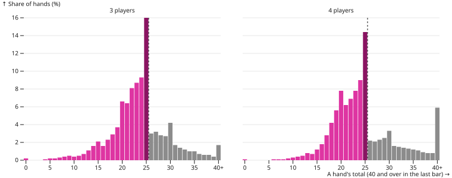

# Fives

Fives is a trick-taking card game from CMYK's Magenta line, designed by Taiki Shinzawa, for 3 or 4
players. You follow the led color if you can, silver is trump, and whoever wins a trick keeps the
card they won it with. At the end of the hand, you want those winning cards to add up to 25, or as
close as you can get without going over. And every card's back is a magenta 5, so any card can be
played face down as one.

This is a strategy guide written by a simulator. It plays millions of games by the rules and
measures what wins: when to take a trick and when to let it go, what to do with high cards, and
when to flip a card to its magenta 5. Every piece of advice below comes with the numbers behind it.

You can play against its bots, or with friends, at [fives.visnup.com](https://fives.visnup.com).

The advice is only as good as the simulation. It follows the How to Play booklet, and where the
booklet leaves a rule open, the appendix says how it was read. It hasn't been checked against real
tables. The simulator and this guide were written with Claude Opus 5.5, working in Claude Code.

## The rules in a minute

The deck is 52 cards: 1 to 13 in blue, green and silver, and 0 to 4 and 6 to 13 in magenta. At 3
players the 10s to 13s come out, and everyone gets 12 cards; at 4, everyone gets 13.

- Whoever holds the magenta 0 leads the first trick of each hand, with any card. Whoever wins a
  trick leads the next.
- Follow the led color if you can. The highest silver wins, or else the highest of the led color.
- Any card can be played face down as a magenta 5, but only one a trick, and only when you lead,
  when magenta is led (even if you hold magenta), when you can't follow, or when your last card of
  the led color is the one you flip.
- Your total is the cards you won tricks with, a face-down card counting 5. Closest to 25 without
  going over takes 3 chips at 4 players (2 at 3), second 2 (1), third 1, and exactly 25 one more.
  A player who goes over, or busts, gives one of their chips to the closest player.
- Everyone starts with 5 chips. After 4 hands, the most chips wins.

## Reading the numbers

Almost every number here is a **win rate**: the share of games a player wins, out of thousands
played from different deals.

- **A fair share** is what you'd win if everyone were equally good: 1 in 3 games (33.3%) at 3
  players and 1 in 4 (25%) at 4. The charts draw it as a dashed line.
- **Points** are percentage points of win rate. A player who wins 30% of games at a 4-player table
  is 5 points over a fair share.
- **The noise.** Any number from a limited number of games is a little off by luck. At 40,000
  games it's within about half a point; at 10,000, one point; at 2,000, about two. A difference
  smaller than that isn't a finding.
- **The bots** are the ones you can play online. **Easy** never plays a card face down. **Medium**
  plays the three rules in the cheat sheet below, and nothing else. **Hard** is a model trained on
  millions of games, the strongest player here; the appendix says how it was built.
- **What a rule is worth**: seat one player who breaks it at a table of Medium bots, and see how
  much less than a fair share they win.

Situations, like what a hand looks like or how often to flip, are measured in games among Hard
bots, since that's what good play looks like. What a rule is worth is measured against Medium.

## How to play well

The cheat sheet, which is all Medium knows:

1. **When you lead and you're 5 or more from 25, lead face down.** Flip your highest silver, or if
   you have none, your highest card. Within 5 of 25, lead your lowest card face up.
2. **Otherwise, play the biggest card that loses the trick,** face down if you're allowed to flip
   it. Don't try to win tricks: they'll come to you.
3. **If every card you have would win, play the biggest that doesn't bust you,** or if they all
   bust, the smallest.

Each one is worth a lot. One player breaking a rule at a table of Medium bots (40,000 games each):

| without this rule | 3 players | 4 players |
| --- | --- | --- |
| nothing missing (the default) | 33.1% | 25.1% |
| never flip a card (Easy) | 11.3% | 3.6% |
| lead your lowest card face up | 21.6% | 10.8% |
| play to win tricks, not to lose them | 25.2% | 10.8% |
| take every trick you're sure to win | 27.6% | 23.7% |

A player who never flips wins a third of a fair share at 3 players and a seventh at 4. Leading your
lowest card face up, the obvious play, costs 12 and 14 points. Playing to win tricks with your
biggest card that doesn't bust costs 8 and 14. The last row is the surprise, and it's how Medium
used to play: take a trick whenever nobody can beat your card and it doesn't bust you. That costs
5.5 points at 3 players and 1.4 at 4. A trick you didn't have to take only adds to your total, and
you'll be handed plenty of tricks anyway.

### What a hand looks like

How often a hand ends on each total, among Hard bots (10,000 games a player count):

Exactly 25 is the most common total of all, 16% of hands at 3 players and 14% at 4. Busting is
common too: 26% and 29% of hands go over. Few end under 15, 6% and 3%. So the game isn't
about collecting points; it's about getting rid of them, and steering the total that piles up on
you anyway to land on 25 rather than past it.

And what each total earns that hand, on average:

From 20 to 24, each point is worth about a fifth of a chip at 3 players and a third at 4, and 25
earns over a chip more than 24. A bust always costs a chip. A low total isn't a disaster: at 3
players, under 13 still earns more than 15 to 19, because when you end that low, other players usually bust, and
their chips go to the closest player.

The table

| a hand's total | 3 players, hands | 3 players, chips | 4 players, hands | 4 players, chips |
| --- | --- | --- | --- | --- |
| 0 | 0.2% | 1.77 | 0.1% | 1.52 |
| 1 | 0.0% | 2.18 | 0.0% | 2.00 |
| 2 | 0.0% | 1.71 | 0.0% | 1.86 |
| 3 | 0.0% | 1.93 | 0.0% | 1.17 |
| 4 | 0.1% | 1.62 | 0.0% | 1.42 |
| 5 | 0.2% | 1.71 | 0.0% | 1.44 |
| 6 | 0.2% | 1.66 | 0.1% | 1.44 |
| 7 | 0.3% | 1.58 | 0.1% | 1.66 |
| 8 | 0.4% | 1.57 | 0.1% | 1.38 |
| 9 | 0.5% | 1.45 | 0.2% | 1.40 |
| 10 | 0.4% | 1.43 | 0.3% | 1.50 |
| 11 | 0.5% | 1.35 | 0.4% | 1.45 |
| 12 | 0.7% | 1.31 | 0.5% | 1.48 |
| 13 | 1.1% | 1.24 | 0.8% | 1.43 |
| 14 | 1.6% | 1.18 | 0.7% | 1.33 |
| 15 | 2.1% | 1.11 | 1.2% | 1.31 |
| 16 | 1.6% | 1.13 | 1.8% | 1.29 |
| 17 | 2.3% | 1.09 | 2.8% | 1.36 |
| 18 | 2.9% | 1.08 | 4.2% | 1.44 |
| 19 | 3.7% | 1.06 | 5.6% | 1.55 |
| 20 | 6.6% | 1.08 | 7.8% | 1.70 |
| 21 | 6.4% | 1.41 | 6.2% | 2.04 |
| 22 | 8.1% | 1.56 | 6.9% | 2.28 |
| 23 | 8.7% | 1.77 | 7.8% | 2.58 |
| 24 | 9.3% | 1.93 | 9.0% | 2.90 |
| 25 | 16.0% | 3.10 | 14.4% | 4.34 |
| 26 (bust) | 3.0% | −1.00 | 2.2% | −1.00 |
| 27 (bust) | 3.2% | −1.00 | 2.1% | −1.00 |
| 28 (bust) | 2.8% | −1.00 | 2.3% | −1.00 |
| 29 (bust) | 2.7% | −1.00 | 2.5% | −1.00 |
| 30 (bust) | 4.2% | −1.00 | 3.3% | −1.00 |
| 31 (bust) | 1.7% | −1.00 | 1.6% | −1.00 |
| 32 (bust) | 1.4% | −1.00 | 1.5% | −1.00 |
| 33 (bust) | 1.2% | −1.00 | 1.4% | −1.00 |
| 34 (bust) | 1.0% | −1.00 | 1.3% | −1.00 |
| 35 (bust) | 1.0% | −1.00 | 1.2% | −1.00 |
| 36 (bust) | 0.7% | −1.00 | 1.1% | −1.00 |
| 37 (bust) | 0.6% | −1.00 | 0.9% | −1.00 |
| 38 (bust) | 0.6% | −1.00 | 0.8% | −1.00 |
| 39 (bust) | 0.4% | −1.00 | 0.8% | −1.00 |
| 40+ (bust) | 1.7% | −1.00 | 5.9% | −1.00 |

### Your magenta 5 is how you get rid of high cards

A card played face down counts 5 if it wins, whatever it is face up. That makes it the cheapest way
to shed a 12 or 13 that would otherwise win a trick and blow your total. A player who never flips
wins 11.3% at 3 players and 3.6% at 4.

How often Hard flips when it's allowed to and has a choice (8,000 games):

| when | flips, 3 players | flips, 4 players | what it flips |
| --- | --- | --- | --- |
| leading, 6 or more from 25 | 55–59% | 67–68% | a high card, silver about half the time |
| leading, within 5 | 37% | 38% | |
| can't follow or flipping your last card of the color, within 5 | 65–79% | 76–81% | its highest card, 5 times in 6 when it can't follow |
| the same, 13 or more from 25 | 68–71% | 63–65% | often a silver, rarely its highest |
| magenta led, 6 or more from 25 | 69–75% | 78–83% | |
| busted | 46–62% | 38–62% | |

Where a row gives a range, it's the range over the four hands of a game. Leading is two thirds of
the chances to flip. Close to 25, flip your biggest card when you can't follow: it counts 5 if it
wins, so it's the safest way to shed it. Far from 25, flip a silver you'd rather not win a trick
with.

Hard flips less often than Medium, which flips every time in most of these rows. But none of its
habits made a better rule for Medium (40,000 games each): leading face down only a card over 5
loses 8 points at 3 players, dumping face up once you've busted changes nothing, and flipping your
highest card when magenta is led gains under a point.

### Lead face down, silver first

When you lead with 5 or more to go, flip your highest silver, or your highest card if you have no
silver. It's the most valuable rule in the game: a player who leads their lowest card face up
instead wins 21.6% and 10.8%.

Why silver first? A high silver is the card most likely to win a trick you didn't want, and then
it adds its whole value to your total. Led face down, it's a magenta 5 at most. Preferring silver
gained 8 points at 3 players and 11 at 4 over just leading your highest card.

Within 5 of 25, a face-down 5 could bust you, so lead your lowest card face up instead.

### Don't chase tricks; duck them

When you follow, play the biggest card that still loses the trick. Ducking is how you shed high
cards when you can't flip them, and the tricks you need come to you anyway: with everyone ducking,
someone still has to win each trick.

That goes for tricks you're sure to win, too. Medium used to take any trick nobody could beat if
it didn't bust, first of all one that made exactly 25. Dropping that gained 4.2 points at 3
players, against Medium, against every earlier version of it, and 3.1 against Hard; at 4 players
it's even. Taking a sure 25 on purpose was worth nothing at either count: the cards that make 25
find you without it.

Ducking does mean busting more. Medium now busts 33% of hands at 3 players and 41% at 4, up from
25% and 38% when it took sure tricks, and hits 25 in 5% of hands, down from 9% and 6% (100,000
games). It wins more anyway: a bust costs one chip, and keeping your high cards out of tricks
pays more often than that.

### Who leads the first trick

Whoever holds the magenta 0 leads each hand's first trick. To tell the lead and the card apart,
`scripts/leads.ts` also plays games where a random other seat leads instead. Among Hard bots
(10,000 games each way):

| who | busts, 3 players | chips a hand, 3 players | busts, 4 players | chips a hand, 4 players |
| --- | --- | --- | --- | --- |
| holds the 0 and leads | 21.9% | 1.17 | 26.8% | 1.57 |
| leads, without the 0 | 24.3% | 1.12 | 26.5% | 1.58 |
| holds the 0, doesn't lead | 24.7% | 1.08 | 30.2% | 1.44 |
| neither | 27.3% | 1.03 | 30.2% | 1.46 |

At 4 players, the lead is what helps: the leader busts 4 points less often and gains an eighth of
a chip more a hand, whether or not they hold the 0, and holding the 0 without leading is worth
nothing. Leading picks the color and gets a high card flipped before anyone has won a trick. At 3
players both help a little and add up: either alone cuts busts by about 3 points, both by 5.

### Playing to the chips

Your chance to win from where the chips stand after a hand, by how far ahead you are of the next
best player (Hard bots, 10,000 games a player count; blank where under 500 cases):

| chips ahead of the next best | 3 players, 3 hands left | 3 players, 2 hands left | 3 players, 1 hand left | 4 players, 3 hands left | 4 players, 2 hands left | 4 players, 1 hand left |
| --- | --- | --- | --- | --- | --- | --- |
| −4 or more | 13% | 9% | 2% | 10% | 8% | 3% |
| −3 | 20% | 18% | 16% | 19% | 17% | 20% |
| −2 | 27% | 25% | 32% | 24% | 22% | 28% |
| −1 | 31% | 33% | 40% | 25% | 28% | 37% |
| 0 | 38% | 42% | 42% | 32% | 38% | 39% |
| +1 | 45% | 50% | 46% | 38% | 46% | 42% |
| +2 | 56% | 59% | 56% | 45% | 52% | 53% |
| +3 | 66% | 66% | 78% | 55% | 59% | 65% |
| +4 |  | 75% | 88% |  | 66% | 82% |
| +5 |  | 84% | 98% |  | 73% | 89% |
| +6 or more |  | 90% | 100% |  | 84% | 97% |

A hand moves a lot of chips: 25 alone is worth 3 or 4, and every bust moves one. So with two or
three hands left, a chip is worth only 5 to 10 points of win chance. In the last hand it's worth up
to 20: 4 ahead with one hand to go wins 82–88% of the time, and 4 or more behind wins 2–3%. Tied
for the lead is better than a fair share, about 40%, since only the leaders can win. But one chip
ahead with a hand to go is worth only 3 or 4 points over a tie: a single hand swings more than that.

### What Hard knows that the rules don't

Hard wins 64.2% of games at 3 players and 54.8% at 4 against a table of Medium bots (20,000 games),
so there's more to good play than three rules. Most of the difference is which card. Against
Medium as it was when it still took sure tricks, Hard picked a different play in 59% of its
decisions, and in half of those it does the same thing,
ducking or taking, face up or down, with another card: it ducks with a lower card than Medium's
biggest 87% of the time. It keeps its high cards for later, likely because it counts cards and
knows when a high card is safe to hold.

None of that makes a simple rule. Ducking with your lowest losing card instead costs 15 to 17
points; ducking with your biggest but keeping your very highest, 2 to 4. Which card to keep
depends on more than a rule of thumb can see.

## How the bots compare

One player against Medium in every other seat (40,000 games; 20,000 for Hard):

| player | 3 players (fair 33.3%) | 4 players (fair 25.0%) |
| --- | --- | --- |
| Hard | 64.2% | 54.8% |
| the old Medium, which took sure tricks | 27.6% | 23.7% |
| Easy: never flips | 11.3% | 3.6% |
| random | 2.3% | 0.7% |
| greedy: takes the lead whenever it doesn't bust | 0.1% | 0.0% |

The chart shows each as a multiple of a fair share: Hard wins about twice its share, Easy a third
at 3 players and a seventh at 4. Seats don't matter: in games among Medium bots, every seat wins
within half a point of a fair share (100,000 games).

## Appendix: how it was built

### The engine and how it reads the rules

`src/game.ts` deals and plays a game by the How to Play booklet, and `src/game.test.ts` checks the
booklet's rules and its scoring example. Where the booklet leaves a rule open:

- Players tied for a place all take the lowest of the places they tie for, as the booklet says,
  also when they tie for first. That decides 10% of hands' chips at 3 players and 14% at 4, but
  taking the higher place instead moves no player's wins beyond the noise (`scripts/rules.ts`,
  20,000 games).
- A bust with no chips gives nothing. When everyone busts, the chips go to a pot for the next
  hand's closest; a pot no one wins in the last hand is lost.
- Chips are unlimited; the box's 42 never run out in practice.

A game among Medium bots takes about 0.1 ms, among Hard bots 26 ms.

### The players

- **Medium** (`defaultPolicy`) is a list of named rules, `STEPS` in `src/game.ts`, tried in order:
  `leadDown`, `duck`, then `least`.
- **Playouts** try every legal play: copy the game, deal the cards you can't see again at random
  (respecting colors someone has shown they're out of), play on with a fixed player in every seat,
  and make the play that wins most. Playing only to the end of the hand and scoring it by
  `chance`, the win chance from the chips (a softmax over players, fit by `scripts/chance.ts`), is
  cheaper and stronger than playing all four hands out.
- **Hard** (`src/learned.ts`) scores each legal play with a learned model and makes the best.

### Where each rule came from

Each rule was found where Hard's choices differ from Medium's (`scripts/overrules.ts`) or where
playouts prefer another play (`scripts/decisions.ts`), written as a variant in
`scripts/variants.ts`, and kept only if it beat Medium beyond the noise and also beat a table of
every earlier Medium (the league), since rules cycle: the best answer to one Medium can be
answered by the next.

| rule | against Medium | against earlier Mediums | against Hard |
| --- | --- | --- | --- |
| lead your highest card face down, 5+ from 25 (Medium used to lead its lowest face up) | +31.8, +24.7 | | +6.2, +2.7 |
| flip your highest silver first | +8.3, +11.3 | +5.8, +6.6 | +1.9, +0.9 |
| at 4 players, last to play early, take only within 12 of 25 (since dropped) | +3.5 at 4 players | +4.3 | +0.8 |
| don't take sure tricks, nor a sure 25, nor dump once busted | +4.2, −0.4 | +4.4, +1.8 | +3.1, 0.0 |

The first number is at 3 players, the second at 4 (40,000 games against Medium, 10,000 to 40,000
against the rest). The last row came from writing this guide: dropping each rule to measure its
worth found that taking sure tricks cost points.

What lost (2,000 games each, or 40,000 where close): leading the lowest card face down, or the
highest face up; 3, 7 or 10 to go as the cutoff for leading face down; flipping the lowest silver;
ducking with your lowest losing card when last early in a hand; taking with your highest card of
the led color when second to play early; taking sure tricks only within 6 to 16 of 25, or only in
a hand's last 4 or 8 cards; and six rules from shallow decision trees fit to Hard's choices
(`scripts/distill.ts`, `distill.py`).

### The learned model

Hard is a gradient-boosted tree model (LightGBM) that scores each legal play by its expected win
chance, and makes the play it scores highest.

- **Features** (`board` and `move` in `src/learned.ts`, version 2). About 90 numbers describe the
  situation: the hand and trick position, every player's total and distance from 25, chips and
  the pot, the led color and the card taking the trick, the counts and highest and lowest card of
  each color in hand, the highest unseen card of each color, and the colors each opponent has
  shown they're out of. Version 2 added card counting: each color's unseen cards and their two
  highest, the cards in hand nothing unseen beats, and who's still to play and what they're out
  of. About 20 more describe the play: its color, face and face-down value, whether it takes the
  trick for now and whether it's sure to, where it leaves the total, how many unseen cards beat it
  and how many players still to play could, and last, whether it's Medium's pick.
- **Labels.** Every decision of a round's games, each legal play valued by hand playouts on 16
  deals of the hidden cards, two hands deep, with the last round's small model in every seat and
  the end scored by `chance`.
- **Fit** (`scripts/learn.py`): least-squares regression on the playout value, 1,500 trees of 127
  leaves, a learning rate of 0.1, at least 200 decisions a leaf, stopped early on held-out shards.
- **Rounds** (`scripts/round.sh`, one command a round, after a smoke test of itself): play 4,000
  to 12,000 games a player count with the last round's model, label them, fit a new model to the
  last few rounds' data, compare it against the last three models and Medium, and fit the small
  version, 50 trees of 31 leaves, which plays inside the next round's playouts at about 8 times
  Medium's cost where the full model is 200. `scripts/status.ts` serves a round's progress.
- **Serving.** The trees are flattened into typed arrays (`src/trees.ts`), and `scoreAll` scores
  all of a decision's plays at once, walking each tree's situation-only branches once. The model
  is packed as base64 into `src/packed/model.ts` so Convex can bundle it for the online game. The
  end-of-game review plays out every option at your decisions, with the small model for Hard
  seats, in a web worker per core.

Each round's model at a table of the one before it (20,000 games, 10,000 from round 5; round 0's
against Medium, 4,000):

| round | 3 players | 4 players |
| --- | --- | --- |
| 1 | 47.5% | 38.6% |
| 2 | 42.2% | 39.9% |
| 3 | 37.1% | 27.5% |
| 4 | 35.3% | 26.5% |
| 5 | 34.8% | 25.2% |
| 6 | 34.7% | 24.9% |
| 7 | 33.5% | 26.0% |
| 8 | 33.5% | 25.8% |
| 8, refit with 1,500 trees of 127 leaves | 35.1% | 25.5% |
| 9 | 33.7% | 25.9% |
| 10, on its own games | 29.8% | 23.7% |
| 10, refit on rounds 7–10 | 32.8% | 24.8% |
| 11, 64 deals a label, one hand, against round 9 | 31.7% | 24.6% |

And against Medium as it was before it led face down:

| round, against the default | 3 players | 4 players |
| --- | --- | --- |
| 0 | 87.0% | 79.6% |
| 1 | 79.6% | 78.0% |
| 2 | 82.8% | 84.7% |
| 3 | 84.6% | 85.3% |
| 4 | 87.1% | 86.2% |
| 5 | 88.2% | 86.7% |
| 6 | 88.9% | 86.8% |
| 7 | 89.4% | 86.4% |
| 8 | 89.5% | 87.4% |
| 9 | 91.0% | 88.6% |

Round 0 learned from Medium's games with Medium inside the playouts, on 32 deals. Round 4 doubled
the games, round 7 added card counting, round 8 rescored a hand's end with `chance` refit to
learned players' games (a chip is worth 40–60% more among strong players), and round 9 labeled two
hands deep with bigger trees. Round 9 is Hard. Rounds 5 on gained under 1.5 points each, and
rounds 10 and 11 lost to round 9, so training stopped.

What caps it is the labels, not the model: playouts among round 6's small models on 16 deals lose
to round 6 itself (25.3% at 3 players, 17.4% at 4), and playouts on top of round 9 need 64 deals
to edge past it (27.1% at 4 players, against a fair 25%), at many times the cost.

Searchers against Medium as it was before this guide, when it still took sure tricks (800 games):

| searcher | 3 players (fair 33.3%) | 4 players (fair 25.0%) |
| --- | --- | --- |
| hand playouts, 32 deals | 63.1% | 62.3% |
| Hard (round 9) | 62.2% | 63.2% |
| full-game playouts, 32 deals | 57.9% | 44.5% |
| hand playouts, 16 deals | 54.8% | 52.7% |

Hard plays about as well as hand playouts on 32 deals, at a tiny fraction of the cost.

### Rerunning it

After `pnpm install`, `node scripts/charts.ts` redraws `charts/` from this README's tables. The
script that made each table is named beside it; `CLAUDE.md` describes the rest.
