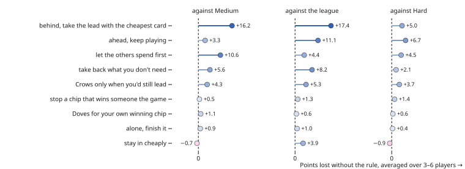
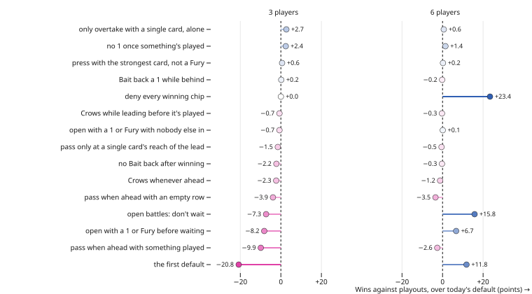

# Hilt

Hilt is a card game for 3 to 6 players from CMYK's Magenta line, designed by Dominique Ehrhard.
It's a game of battles. Everyone gets 10 cards. In each battle you go around the table, playing a
card into a row in front of you or passing. Whoever has the most strength when everyone has
passed wins a chip. Three chips of a color, or one of each color, win the game. Nobody draws
between battles. The cards you spend winning one battle are gone until the round ends.

This is a strategy guide written by a simulator. The simulator plays millions of games by the
rules and measures what wins: when to fight for a chip and when to let it go, how to hold a lead,
what to do with each fate card. Every piece of advice below comes with the numbers behind it.

You can play against its bots, or with friends, at [hilt.visnup.com](https://hilt.visnup.com).

The advice is only as good as the simulation. The simulation follows the How to Play booklet.
Where the booklet leaves a rule open, the appendix says how the simulator reads it. Nobody has
checked the simulator against real tables. Claude Opus 5.5 wrote the simulator and this guide in
Claude Code.

## The rules in a minute

The deck is 96 cards. The force cards are 1s (15 of them) and 2s, 3s, 4s, 5s, 6s and 10s (8 each).
The fate cards change the battle:

- **Bait** (15): discard it to take a force card from your row back into your hand.
- **Fury** (6): your force cards count double. You can play one Fury a battle.
- **Legend** (3): 10 strength that nothing changes.
- **Winter** (3): every force card in the battle is worth 1. Players can play only one Winter
  a battle.
- **Crows** (3): the battle ends at once. Whoever leads wins.
- **Doves** (3): the battle ends at once with no winner. The chip and the Favor stay where they
  are.

The rest:

- Whoever won the last battle holds the Favor. The Favor holder picks which color of chip the next
  battle is over and has 1 strength before anyone plays. Play starts at the Favor holder's left.
- Each turn you play a card or pass. A pass is for the rest of the battle.
- The most strength wins. Ties go to fewer cards played, then the highest card, then the player
  closest clockwise from the Favor holder.
- When a battle leaves only one player with cards, that player discards them. When a battle leaves
  nobody with cards, the round ends too. Then everyone gets 10 new cards plus one for each chip
  they hold.
- A player who passes with no force cards in hand may show it and discard it.

## Reading the numbers

Almost every number here is a **win rate**: the share of games a player wins, out of thousands
played from different deals.

- **A fair share** is what you'd win if everyone were equally good: 1 in however many are at the
  table. That's 33.3% at 3 players and 16.7% at 6. A column headed "3 players (fair 33.3%)" says
  which share to compare with.
- **Points** are percentage points of win rate. A rule worth 4 points takes a player from 33.3% to
  37.3% of games at 3 players.
- **Fair shares** divide a win rate by a fair share. A player at 2 fair shares wins twice as often
  as an even player would: 66.7% at 3 players or 33.3% at 6. Fair shares compare player counts. The
  same points mean more at a bigger table.
- **The noise.** Any number from a limited number of games is a little off by luck. At 40,000 games
  it's within about half a point. At 10,000 it's within about a point. At 4,000 it's within about a
  point and a half. A difference smaller than that isn't a finding.
- **The bots** are the ones you can play online. **Easy** fights every battle, like a new player.
  **Medium** plays the cheat sheet below. **Hard** is a model that learned from millions of games.
  Hard is the strongest bot online. The appendix says how we built Hard.
- **The league** is a table of Medium's earlier versions. Each other seat holds one of them, at
  random. Each version of Medium beat the one before it. A rule that also beats the league isn't
  just a trick against today's Medium.
- **What a rule is worth** is how much less one player wins by breaking that rule. We measure it
  three ways: at a table of Medium bots, at a table of the league and at a table of Hard bots.

What battles look like comes from games among Hard bots. Hard's games are what
good play looks like. What a rule is worth comes from one player at each of the three tables.

`node scripts/charts.ts` draws the charts from this guide's own tables.

## How to play well

The cheat sheet, in the order Medium tries the rules. The first rule that fits the moment decides
the move:

1. **Take back what you don't need.** Once everyone else has passed, play Bait to take back the
   biggest card that still leaves you ahead. Then pass to win. With others still in and a lead of
   more than 4, take back the biggest card that keeps a lead that big. Before you give up a
   battle, take back your biggest card.
2. **Crows only when you'd still lead with it.** Crows ends the battle for whoever leads. Play it
   with a card of your own down. Crows counts as a card for the tie-break. So check that you'd
   still lead with Crows in your row.
3. **Doves for your own winning chip.** Behind in a battle for the chip that would win you the
   game, play Doves. The chip comes up again next battle. Also play Doves when the chip would win
   the leader the game and nobody else is left to stop them.
4. **Ahead, keep playing.** Passing is final. Once you lead, keep playing until the others give
   up. Ahead with nothing down, as the Favor holder is at first, play a Fury or else your
   strongest card. Ahead with something down, play a Fury or else your weakest force card.
5. **Stop a chip that wins someone the game.** At 3 players, deny it with your strongest card.
   With fewer than 3 others still in, take the lead from that player with the cheapest card that
   does it.
6. **Let the others spend first.** Behind with nothing down and 2 or more others still in, pass.
7. **Alone, finish it.** With nobody else left in, play your strongest card if your hand would
   overtake. Rule 1 takes back what you didn't need.
8. **Stay in cheaply.** Behind, play a 1 before anything that would take the lead. This rule only
   pays against weaker players.
9. **Behind, take the lead with the cheapest card that does it,** however much the battle has cost
   you. If the chip would win you the game, play your strongest card even if it doesn't take the
   lead.

Two choices come outside battles:

- **The chip.** As the Favor holder, pick the chip that leaves you fewest from winning. Break ties
  with the one that helps the closest opponent least.
- **A hand with no force cards.** When you pass holding no force cards, discard your hand.

What each rule is worth: one player breaks it, at each kind of table, in points at 3 / 4 / 5 / 6
players (`variants.ts`, "without this rule", 40,000 games against Medium and the league, 10,000
against Hard):

| rule | against Medium | against the league | against Hard |
| --- | --- | --- | --- |
| behind, take the lead with the cheapest card | 18.8 / 18.7 / 15.2 / 12.2 | 26.4 / 18.0 / 14.1 / 10.9 | 6.6 / 4.2 / 3.3 / 2.9 |
| ahead, keep playing | 12.9 / 3.6 / −0.6 / −2.9 | 23.6 / 10.2 / 6.9 / 3.6 | 8.1 / 6.4 / 4.7 / 4.5 |
| let the others spend first | 7.5 / 12.4 / 12.2 / 10.4 | 4.1 / 6.5 / 4.2 / 2.9 | 2.0 / 3.8 / 3.9 / 4.6 |
| take back what you don't need | 7.3 / 5.4 / 5.3 / 4.3 | 11.7 / 7.9 / 7.1 / 6.1 | 1.5 / 2.2 / 2.1 / 1.8 |
| Crows only when you'd still lead | 4.7 / 4.6 / 4.3 / 3.4 | 7.1 / 5.6 / 4.6 / 3.9 | 6.2 / 3.5 / 2.6 / 2.0 |
| stop a chip that wins someone the game | 0.6 / 0.4 / 0.5 / 0.5 | 3.4 / 0.7 / 0.7 / 0.5 | 1.6 / 1.3 / 0.9 / 1.0 |
| Doves for your own winning chip | 3.2 / 0.6 / 0.5 / 0.2 | 2.3 / 0.4 / 0.0 / −0.1 | 0.9 / 0.6 / 0.5 / 0.3 |
| alone, finish it | 1.9 / 0.9 / 0.6 / 0.3 | 1.8 / 1.3 / 0.6 / 0.2 | 1.1 / 0.1 / −0.1 / 0.0 |
| stay in cheaply | 0.4 / −1.7 / −0.6 / −0.8 | 5.5 / 3.8 / 3.3 / 2.9 | −1.2 / −0.3 / −0.6 / −0.3 |

Against Hard, a Medium bot wins 11.4%, 9.4%, 7.7% and 7.2% at 3–6 players. So the same points
are a bigger share of what it wins there.

Two rules are bets on the table. "Ahead, keep playing" costs 0.6 points at a 5-player table of
Medium bots and 2.9 at a 6-player one. At every other table it pays, by up to 24 points. "Stay in cheaply" pays only against
the league. Against Medium and Hard it costs up to 1.7 points. The sections below say why.

### What a battle looks like

Most battles aren't worth fighting. Among Hard bots, 63% of the players sit a battle out without
playing a card at 6 players. At 3 players, 24% do. Battles get cheaper as the table grows. At 3
players, everyone together plays about 11 cards a battle. At 6, they play about 6. The winner
needs less, too: 21.3 strength at 3 players and 11.1 at 6. 4,000 games among Hard bots
(`scripts/battles.ts`):

| among Hard bots | 3 players | 4 players | 5 players | 6 players |
| --- | --- | --- | --- | --- |
| battles a game | 7.7 | 8.0 | 8.7 | 9.5 |
| rounds a game | 3.1 | 1.5 | 1.3 | 1.2 |
| games won with three of a color | 81% | 72% | 69% | 70% |
| games won with one of each | 19% | 28% | 31% | 30% |
| cards played a battle, everyone together | 10.8 | 6.4 | 5.9 | 5.6 |
| players who sit a battle out without playing | 24% | 46% | 56% | 63% |
| the winner's strength | 21.3 | 12.7 | 11.6 | 11.1 |
| cards in the winner's row | 4.5 | 2.8 | 2.5 | 2.4 |
| battles the Favor holder wins | 28% | 29% | 28% | 25% |
| battles Crows ends | 26% | 17% | 16% | 16% |
| battles Doves ends | 24% | 17% | 17% | 17% |

At 3 players, a game lasts about three rounds. At 4 to 6, most games end in the first round. So at
a big table, the 10 cards you're dealt are usually all you get. Crows or Doves ends half of all
battles at 3 players. At 4 to 6, they end about a third.

### Behind, take the lead with the cheapest card

Once you're in a battle, fight it out. Take the lead with the cheapest card that does it. Do that
again each time someone overtakes you. Medium counts Crows as free, then force cards by their value.
It counts a Fury or a Winter like a 3 and a Legend like a 10. If the chip would win you the game,
play your strongest card even when it falls short of the lead.

This rule is worth more than any other: 12 to 19 points against Medium and 11 to 26 against the
league. Without it you'd pass the moment you fell behind. Then any player could buy the chip with
a single card.

Medium used to give up once a battle had cost it 3 cards. A person exploited that limit. One on one
with Medium, they stayed just ahead until Medium stopped with 6 cards still in hand. Then they
Baited back what they'd spent. Without the limit, Medium wins 3.3, 2.6, 1.8 and 1.5 points more at
3–6 players against the version with it. It wins 1.7, 1.2, 0.9 and 0.6 more against the league
(40,000 games). A limit of 5 cards does as well as no limit.

### Ahead, keep playing

Passing is final. A pass while you lead leaves the others free to overtake you. Then you can't
answer. So keep adding cards while you lead and others are still in. With nothing down yet, play a
Fury, or else your strongest card. The Favor holder is in this spot at the start of every battle.
With something down, play a Fury, or else your weakest force card. Keep going until the others
give up.

This rule came from Hard. Hard's moves differ from Medium's at 74% of its decisions at 3 players
and 49% at 6. Most of those differences are plays where Medium passed. The largest group was ahead
with a card down and one other player still in. Medium had no rule there and passed. Playing the
weakest force card instead won 50.5%, 34.7%, 26.4% and 21.8% at 3–6 players against that Medium
(40,000 games). The strongest card does about as well against Medium. Against the league, the
strongest card does a little worse.

At a 6-player table of today's Medium bots, this rule costs 2.9 points. Those bots chase every
lead. Perhaps a lead held against 5 of them draws cards out of all 5 (hypothesis, untested). Against
the league it's worth 3.6 to 24 points. Against Hard it's worth 4.5 to 8.1. Keep playing.

### Let the others spend first

Behind with nothing down and 2 or more others still in, pass. Let them spend their cards on
each other. The exceptions are a chip that would win you the game and a chip that would win
someone else the game (the next section).

Waiting is worth 7.5 to 12.4 points against Medium and 2.0 to 4.6 against Hard. The bigger the
table, the more it's worth against Hard. At 6 players, it's worth 4.6 points there. The first
Medium fought every battle. Against that Medium, a waiting player won 58.8% at 3 players and 70 to
72% at 4–6 (40,000 games).

Waiting is a bet on the others fighting. Against players who all wait too, opening wins again. So
we tried mixing: wait some of the time and open the rest. No table could then exploit you. Waiting
25%, 50% or 75% of the time lost 1.6 to 7.3 points against Medium and up to 3.6 against the league
(4,000 games). Waiting every time stays.

Medium used to open with a 1 or a Fury once fewer than 2 others were in. That opening was worth
something only while Medium gave up after 3 cards. Without the opening, Medium wins 0.4 to 1.0
points more against the version with it. It ties the league.

### Stop a chip that wins someone the game

When a chip would win someone else the game, somebody has to stop them. At 3 players that's you:
deny the chip with your strongest card. At 4 to 6 players, leave it to the others while 3 or more
of them are still in. With fewer than 3 others in, take the lead from the threat with the cheapest
card that does it.

At 3 players, the strongest card came from Hard. Hard plays 10s there where Medium used to wait or
open with a 1. The strongest card is worth 6.4 points against Medium and 3.5 against the league
(40,000 games). Against Hard it ties. At 4 to 6 players, the same move loses up to 3.5 against
the league.

Taking the lead with fewer than 3 others in started with a person's game. In it, the person's
passes on a chip that won Bot 1 the game cost them 54 and 66 points. Medium opened with a 1 there.
A 1 rarely takes the lead. Taking the lead instead wins 3.4, 3.9, 2.7 and 1.9 points more at 3–6
players against that Medium (40,000 games). It gains 1.8 to 2.5 points against Hard. Doing it with
3 or more others in loses 0.4 to 3.6 points against the league at 4–6 players.

Who stops the threat is a free-rider problem. Everyone wants someone else to pay for it. Which
answer wins depends on the table. One player of each kind at a table of the other (40,000 games):

| one player | table | 4 players | 5 players | 6 players |
| --- | --- | --- | --- | --- |
| leaves it to others (Medium) | denies every winning chip | 27.7% | 27.8% | 26.6% |
| denies every winning chip | leaves it to others (Medium) | 22.4% | 14.6% | 11.1% |
| leaves it to others (Medium) | opens without waiting | 31.9% | 33.3% | 33.0% |
| denies every winning chip | opens without waiting | 37.5% | 38.6% | 39.7% |

Among players who deny, leaving it to them wins 1.1 fair shares at 4 players and 1.6 at 6. Among
players who open every battle without waiting, denying yourself is better.

**Deals.** The booklet allows deals. Nothing makes a deal binding. The deal this problem asks for
is "you stop this one". When the chip would win someone the game, one named player denies it.
Everyone else stays out. We named the next player still in after the threat. At a table that has
made the deal (10,000 games, `variants.ts`, "deal:"):

| one player | 3 players | 4 players | 5 players | 6 players |
| --- | --- | --- | --- | --- |
| keeps the deal | 34.0% | 25.6% | 20.0% | 16.8% |
| makes the deal and never denies | 32.0% | 25.2% | 19.0% | 15.7% |
| never made it (Medium) | 36.3% | 28.8% | 21.6% | 17.4% |
| keeps the deal at a table of Medium bots | 31.9% | 22.5% | 15.6% | 12.2% |

The deal mostly keeps itself. A named player who doesn't deny hands the threat the game. That
player loses 0.4 to 2 points. But the player who never made the deal does better than anyone at
the table: 3 to 3.8 points over a fair share at 3 and 4 players. Making the deal alone at a table
that hasn't costs 1.7 to 4.8 points. Making the deal never beats staying out of it. If the others make it without you, stay
out of it.

### Crows only when you'd still lead

Crows wins the battle on the spot for whoever leads. So play Crows only when that's you. Play it
only with a card of your own down. The Favor's 1 strength alone isn't enough. Crows also counts as
a card in your row. Ties go to fewer cards. So Crows can hand away a tie you were winning. Before
you play Crows, count it and check that you still lead.

Playing Crows this way is worth 3.4 to 4.7 points against Medium, 3.9 to 7.1 against the league and
2.0 to 6.2 against Hard. Playing Crows only with a card down came first. It gained 2 to 5 points
over Crows whenever ahead. Medium then checked the lead only before playing Crows. 27% of its
Crows plays lost the battle (8,953 of 33,171, in 20,000 games). Counting Crows in the row gains
2.2, 1.6, 1.2 and 0.8 points at 3–6 players against that Medium. It gains 1.9, 2.3, 1.6 and 1.1
against the league (40,000 games).

### Take back what you don't need

Bait can only take back a force card from your own row. So Bait is never a way into a battle. Bait
is a way to spend less in one. Bait has three uses:

- Once everyone else has passed, take back the biggest card that still leaves you ahead. That
  brings home the 10 that won the battle. That alone is worth 2 to 4 points.
- Leading by more than 4 with others still in, take back the biggest card that keeps that lead.
- Before you give up a battle, take back your biggest force card.

Together these are worth 4.3 to 7.3 points against Medium and 6.1 to 11.7 against the league.
Against Hard they're worth 1.5 to 2.2.

Medium used to Bait back a 1 while behind with others still in. That kept it in the battle for
nothing. Dropping that use won 1.3, 1.7, 1.1 and 0.8 points at 3–6 players against Medium (40,000
games). It tied the league and Hard. So we dropped it.

### Alone, finish it

With nobody else left in, nobody can answer. If your hand would overtake the leader, play your
strongest card. Then play the next strongest until you lead. Rule 1 then takes back what you
didn't need. This is worth 0.3 to 1.9 points against Medium and the league. Against Hard it's worth
1.1 points at 3 players and nothing at 4 to 6.

### Doves for your own winning chip

Doves ends the battle with no winner. Everything played in it is gone. Everyone fights over the
same chip again next battle. The Favor stays where it is. So Doves is a second chance at your own
winning chip. Say you're losing the battle for the chip that would end the game in your favor. Void
it with Doves. Also play Doves on someone else's winning chip once nobody else is left in to stop
them.

This rule is worth 3.2 points at 3 players against Medium. At 4 to 6 players it's worth half a
point at most. Doves is a poor card in an opening hand: about 2.5 points below a random card. We
looked at every chance to play Doves on someone else's lead in 16,000 games. Playouts on 64 deals
scored each chance (`scripts/fates.ts` as of 75b7650):

| when you could play Doves | how often, a game | Doves gains, points | Doves better |
| --- | --- | --- | --- |
| the chip would win you the game | 0.44 | 5.4 | 63% |
| …and it's one on one | 0.09 | 8.0 to 11.0 | 66 to 70% |
| you hold the Favor | 0.80 | 4.2 | 60% |
| the others have more than 4 cards down | 0.47 | 3.4 | 58% |
| the leader has put down a quarter to half their hand | 0.56 | 3.4 | 56% |
| the leader has 3 to 5 cards left | 0.69 | 2.7 | 46% |
| the others have nothing down yet | 1.00 | −0.6 | 19% |
| the chip would win the leader the game | 0.39 | −0.8 | 24% |
| nobody else is still in | 0.17 | −8.0 | 37% |

Doves also pays to keep the Favor. Doves pays to wipe out a battle the others have poured cards
into. Adding either to the rule gains nothing more. A Doves spent there likely isn't in your hand
when your own winning chip comes up (hypothesis, untested). Don't play Doves on someone else's
winning chip while others are still in. Don't play it when nobody else is in, either. There you
can overtake with nobody to answer.

### Stay in cheaply, against weaker players

Behind, play a 1 before anything that would take the lead. A 1 keeps you in the battle for almost
nothing. This rule is a bet on weak players. Against the league it's worth 2.9 to 5.5 points.
Against Medium it costs up to 1.7 points at 4 to 6 players. Against Hard it costs 1.2 points at
3 players.

The bet is all one on one. Playing a 1 only with 2 or more others in plays the same as never
playing it. Playing a 1 only with 1 other in plays the same as the rule (4,000 games). Why is untested. Against a table you don't know,
skip the 1 and take the lead.

### The fate cards

The table above the cheat sheet says what each rule is worth. This one says what each fate card is
worth to play well. One player plays as if the card weren't in its hand. The points it loses
(`variants.ts`, "never play", 10,000 games), at 3 / 4 / 5 / 6 players:

| playing it as Medium does | against Medium | against the league |
| --- | --- | --- |
| Fury | 16.7 / 11.3 / 9.1 / 7.2 | 16.6 / 9.1 / 7.5 / 6.1 |
| Legend | 9.7 / 7.5 / 5.8 / 4.6 | 9.1 / 5.2 / 4.8 / 3.9 |
| Bait | 8.1 / 5.9 / 5.3 / 4.8 | 11.7 / 7.9 / 7.3 / 6.0 |
| Crows | 5.3 / 4.9 / 4.6 / 3.2 | 6.8 / 5.6 / 4.9 / 4.1 |
| Winter | 3.6 / 2.3 / 1.9 / 1.4 | 3.3 / 1.7 / 1.7 / 1.3 |
| Doves | 3.4 / 0.5 / 0.5 / 0.4 | 2.3 / 0.5 / 0.1 / 0.0 |

**Fury** is the card to play well. Fury doubles every force card in your row, the ones you play
after it included. As the Favor holder with nothing down, lead with a Fury before your strongest
card. Once you lead with something down and others still in, play it before your weakest card.
Under Winter, a Fury still makes your force cards 2 each.

**Legend** is a 10 that Winter can't touch and Fury doesn't double. Spend it like a 10: as the
Favor holder's strong opener, to finish a battle nobody else is in, or when the chip decides the
game. In a Winter battle it's the strongest card at the table by far.

**Winter** turns every force card into a 1 for the rest of the battle. So Winter helps whoever has
more cards down, or a Legend. Medium plays Winter only when Winter takes the lead outright. Medium
counts Winter as cheap as a 3.

We played out every other fate card at every chance in 16,000 Medium games (`scripts/fates.ts
--card <fate>`). Where Medium doesn't play the card, the gain from playing it:

| fate card | chances a game Medium passes up | gain there, points | where it gains most |
| --- | --- | --- | --- |
| Bait | 8.2 | 2.2 | you lead by more than 10: 3.8 |
| Legend | 4.1 | 0.8 | Winter's out: 3.8 |
| Fury | 5.6 | −1.1 | you lead by 5 to 10: 5.8; by more: 8.2 |
| Doves | 5.0 | −3.1 | you're more than 10 behind: 1.8 |
| Winter | 5.8 | −2.7 | nowhere |
| Crows | 4.1 | −16.4 | nowhere |

Bait and Fury while leading became rules 1 and 4. Legend's gains are spread too thin to make a rule
of. Every other chance to play Winter, Doves or Crows loses.

### Which chip to fight over

As the Favor holder, you pick the chip for the next battle. Pick the one that leaves you fewest
chips from winning. Break ties with the one that helps the closest opponent least. Against Medium
(`variants.ts`, 40,000 games):

| chip | 3 players | 4 players | 5 players | 6 players |
| --- | --- | --- | --- | --- |
| Medium's | 33.6% | 24.9% | 20.4% | 16.6% |
| by playouts, 32 deals | 36.3% | 26.6% | 22.0% | 18.2% |
| helping the closest opponent least, first | 30.6% | 23.4% | 19.0% | 15.4% |
| our own progress only | 34.3% | 24.5% | 20.3% | 16.9% |
| at random | 27.5% | 19.2% | 15.5% | 12.5% |

The pick is worth 4 to 6 points over picking at random. Medium's rule gets most of that. Playing
each chip out gains 1.6 to 2.7 points more. Your own progress comes first. Blocking the closest
opponent first costs up to 3 points.

### A hand with no force cards

When you pass holding no force cards, show your hand and discard it. Nobody draws until only one
player has cards left. So emptying your hand brings the next deal closer. At the next deal you get
10 fresh cards and one more for each chip you hold. Against Medium (`variants.ts`, 40,000 games):

| on passing with no force cards | 3 players | 4 players | 5 players | 6 players |
| --- | --- | --- | --- | --- |
| discard (Medium) | 33.6% | 24.9% | 20.4% | 16.6% |
| discard or keep, by playouts on 32 deals | 34.2% | 25.3% | 21.0% | 17.1% |
| keep the hand | 25.3% | 20.2% | 17.5% | 14.6% |

Always discarding is within 0.6 points of playing each choice out. The fate cards left in such a
hand are worth less than getting to the next deal sooner. Keeping them costs 8.3 points at 3
players and 2 at 6.

### Where you sit

The Favor starts in seat 1. Seat 1 acts last in the first battle. Seat 2 acts first. 100,000 games
among Medium bots (`scripts/sim.ts`):

| players | seat 1 | seat 2 | seat 3 | seat 4 | seat 5 | seat 6 | battles | rounds |
| --- | --- | --- | --- | --- | --- | --- | --- | --- |
| 3 | 37.0% | 35.2% | 27.9% | | | | 7.4 | 2.6 |
| 4 | 22.3% | 33.5% | 27.6% | 16.6% | | | 8.9 | 2.3 |
| 5 | 19.4% | 28.7% | 19.7% | 20.5% | 11.7% | | 10.2 | 2.1 |
| 6 | 15.9% | 28.9% | 16.7% | 13.7% | 15.7% | 9.1% | 11.2 | 2.0 |

Seat 2 is best: 1.3 fair shares at 4 players and 1.7 at 6. The last seat is worst: 0.5 to 0.8 of a
fair share. The Favor seat does best only at 3 players. Who the first battle favors depends on how
people play it. The first Medium fought every battle. Under it, the Favor seat won 40.5% at 3
players and 29.3% at 6. Seat 2 then got the worst share but one.

### What each card is worth

The points one more copy in an opening hand adds, in place of a random card. Each deal plays both
ways (`scripts/cards.ts`, 200,000 deals each, among Medium bots):

| card | 3 players | 4 players | 5 players | 6 players |
| --- | --- | --- | --- | --- |
| 10 | 5.7 | 5.7 | 4.3 | 4.1 |
| Legend | 5.0 | 4.4 | 3.6 | 3.4 |
| 6 | 1.7 | 2.0 | 1.5 | 1.5 |
| Fury | 1.5 | 1.5 | 0.9 | 0.7 |
| Crows | 1.2 | 2.7 | 2.2 | 2.4 |
| 5 | 0.7 | 0.8 | 0.7 | 0.7 |
| 4 | −0.2 | −0.1 | −0.2 | −0.0 |
| Winter | −0.5 | −0.9 | −0.6 | −0.6 |
| 3 | −1.2 | −1.3 | −1.0 | −0.8 |
| Bait | −1.7 | −0.7 | −1.0 | −1.0 |
| 2 | −2.4 | −2.3 | −2.0 | −1.8 |
| Doves | −2.7 | −2.8 | −2.5 | −2.5 |
| 1 | −3.2 | −3.6 | −2.7 | −2.5 |

These values are against a random card. A card worth nothing is about average. Force cards are
worth about their value: a 10 the most and a 1 the least. A Legend is worth nearly a 10. What a
card is worth depends on how people play it. Against the first Medium, a 10 or a Legend was worth
8 to 12 points. Crows was worth −6.5 to −10 then. Crows was worth 4 to 5 points at 4 to 6 players
until Medium stopped Baiting back 1s. It's worth about half that now (hypothesis for why, untested).

### Reading the table

Watch who passes early and who spends. Answer those players. Don't answer an imagined opponent who
plays like you. Playouts play every move out to the end on deals of the cards they can't see. They
have to guess how the others play on. At a table of the league, playouts guessing three ways
(`variants.ts --field league`, 4,000 games):

| playouts, guessing the others play | 3 players | 4 players | 5 players | 6 players |
| --- | --- | --- | --- | --- |
| 32 deals, like today's Medium | 40.1% | 33.2% | 25.8% | 22.2% |
| 32 deals, like a league Medium at random | 50.5% | 40.6% | 32.3% | 26.9% |
| 32 deals, like the league Medium actually in each seat | 67.5% | 58.3% | 49.2% | 45.5% |
| 8 deals, like today's Medium | 18.6% | 17.1% | 12.6% | 10.1% |
| 8 deals, like a league Medium at random | 28.9% | 22.2% | 15.1% | 14.5% |
| 8 deals, like the league Medium actually in each seat | 39.7% | 34.9% | 29.1% | 26.4% |
| today's Medium, for comparison | 48.3% | 34.1% | 26.6% | 22.2% |

Knowing how each player plays is worth 23 to 27 points at 32 deals. That's more than quadrupling
the deals. Knowing what kinds of players sit at the table is worth 5 to 10 of those points. The
rest is knowing who's who. The versions of Medium differ most in what you can see: who waits, who
opens with a 1 and who chases every battle.

## How the bots compare

One player of each kind against Medium in every other seat (`scripts/strategies.ts`, 100,000
games; playouts 4,000):

| strategy | 3 players | 4 players | 5 players | 6 players |
| --- | --- | --- | --- | --- |
| default | 33.6% | 24.9% | 20.3% | 16.6% |
| learned, Hard | 67.9% | 50.5% | 45.2% | 40.0% |
| playouts, 128 deals | 66.5% | 59.3% | 51.4% | 47.2% |
| playouts, 32 deals | 52.6% | 43.4% | 34.8% | 32.5% |
| playouts, 8 deals | 25.7% | 19.1% | 16.6% | 16.4% |
| first default, Easy | 10.5% | 2.6% | 1.9% | 1.4% |
| spender: chase every battle | 10.1% | 2.9% | 2.2% | 1.7% |
| no Bait | 11.0% | 3.3% | 2.5% | 2.1% |
| random | 1.0% | 0.6% | 0.4% | 0.3% |
| passive: never play | 0.0% | 0.0% | 0.0% | 0.0% |

"Default" is Medium. Hard wins 2.0 to 2.4 fair shares against Medium. Against the league, Hard wins
70.3%, 54.9%, 48.4% and 42.4% at 3–6 players (20,000 games). Easy wins a tenth of a fair share or
less at 4 to 6 players. Spending to win every battle is ruinous. So is never taking a card back
with Bait.

At 4 to 6 players, playouts on 128 deals win more against Medium than Hard does. Playouts cost thousands of games a decision, though. Playouts can
also race. Racing plays the moves out 8 deals at a time on the same deals. It drops a move once
that move is 2 standard errors behind the leader. That spends the deals on the moves still in
contention. Playouts can also play out only the 3 moves Hard ranks highest. Against Medium (4,000
games):

| playouts | 3 players | 4 players | 5 players | 6 players |
| --- | --- | --- | --- | --- |
| racing, up to 128 deals | 66.7% | 58.3% | 49.8% | 47.3% |
| racing, Hard's top 3 moves | 69.0% | 56.1% | 48.6% | 43.1% |
| racing, up to 512 deals | 70.0% | 62.3% | 56.1% | 54.9% |
| racing, up to 512 deals, Hard's top 3 moves | 71.7% | 59.6% | 51.3% | 46.0% |

Racing on 128 deals costs 0.6 times as much as 128 full deals. Racing ties full playouts on 128
deals. Pruning to Hard's top 3 ties at 3 players and loses up to 9 points at 6. So there's still
room above Hard.

## Appendix: under the hood

### How the simulator reads the rules

The booklet leaves a few things open. The simulator reads them this way:

- Bait needs a force card in your row to take back. Without one, you can't play Bait.
- Fate cards played to your row (Fury, Legend, Crows, Doves) count as cards played for the
  tie-break. Bait and Winter don't stay in a row. So they don't count. The Favor isn't a card
  played.
- "Highest single value card" is the printed value. A Legend is 10 and a 10 is 10, even under
  Winter.
- A Favor holder with no cards still has the Favor's 1 strength.
- A battle that leaves nobody with cards ends the round. Everyone gets a fresh deal from a full
  reshuffle.
- A player with no cards is out of a battle from its start. Nobody asks them to move.

Condottiere, the game Hilt reworks, agrees on the fifth. Whether a Favor holder with no cards keeps the Favor's 1 strength
comes up in 6% of battles at 3 players and 15% at 6. Either reading gives the same wins by seat,
within half a point. Either reading gives the same game length, within a tenth of a battle
(`scripts/rules.ts`, 100,000 games each).

### Medium's rules, and where they came from

Medium is `defaultPolicy` in `src/game.ts`. It's a list of steps it tries in order, `STEPS`. Each
step has a comment with the numbers that adopted it. We found each step by playing out every legal
move at Medium's decisions (`scripts/decisions.ts`), or by reading where Hard's picks differ from
Medium's (`scripts/overrules.ts`). A step was adopted when it beat Medium head to head
(`scripts/variants.ts`). The old behaviour stays in `variants.ts` as a "(previous)" variant.

The first Medium had only three steps: Crows whenever ahead, take the lead with the cheapest card
and Bait back before giving up. That first Medium is Easy now. Each step after that was the best
answer to the Medium before it. The rules don't settle. Once everyone waits, opening pays again.
Once everyone opens, waiting does. So from the fifth version on, we also judged steps against the
league (`variants.ts --field league`). A step stayed only if it won there too. Bait back a 1 while
ahead, for one, gained 4 to 7 points against the Medium of its day. Against the league, it lost a point.

Each step again, with playouts on 8 deals in every other seat (`variants.ts --field playouts`,
6,000 games, noise ±1.2 points at 3 players and ±1 at 6):

| without the rule | 3 players | 6 players |
| --- | --- | --- |
| only overtake with a single card, alone | 62.9% | 26.2% |
| no 1 once something's played | 62.6% | 27.0% |
| press with the strongest card, not a Fury | 60.8% | 25.8% |
| Bait back a 1 while behind | 60.4% | 25.4% |
| today's default | 60.2% | 25.6% |
| deny every winning chip | 60.2% | 49.0% |
| Crows while leading before it's played | 59.5% | 25.3% |
| open with a 1 or Fury with nobody else in | 59.5% | 25.7% |
| pass only at a single card's reach of the lead | 58.7% | 25.1% |
| no Bait back after winning | 58.0% | 25.3% |
| Crows whenever ahead | 57.9% | 24.4% |
| pass when ahead with an empty row | 56.3% | 22.1% |
| open battles: don't wait | 52.9% | 41.4% |
| open with a 1 or Fury before waiting | 52.0% | 32.3% |
| pass when ahead with something played | 50.3% | 23.0% |
| the first default | 39.4% | 37.4% |

Against playouts, Medium wins 60.2% at 3 players. Leaving a winning chip for the others to deny is
a bet on the others. Playouts expect the others to deny it. So among playouts, nobody does. There,
denying it yourself is worth 23 points at 6 players. Waiting is the same bet at 6 players. Against
playouts, opening wins 15.8 points more there.

### Hard: the learned model

Playouts play every legal move out to the end and make the best one. But playouts cost thousands
of games a decision. So Hard learned to predict what playouts would say.

- **Data.** `scripts/dataset.ts` plays games. At every decision of one player, it plays every legal
  move out to the end on 32 shared deals (16 in later rounds). Each move's label is its playout win
  rate.
- **Features.** Hard sees 53 numbers about the board and 20 about the move. Since round 11 those
  include card counting: how many of each kind of card Hard hasn't seen yet, and how many unseen
  cards beat the card a move plays. One of the move's
  numbers is whether Medium would pick it. That Medium is frozen at the version every model so far
  trained on (`hint` in `src/learned.ts`).
- **Trees.** `scripts/learn.py` fits gradient-boosted trees (LightGBM, 1,000 trees) to predict each
  move's label. `src/learned.ts` plays the move the trees rank first.
- **Rounds.** Hard reaches boards Medium never does. So each round after the first trains on games
  the last round's model played (`dataset.ts --play`). From round 3 on, the playouts inside the
  labels play on with a learned model too (`dataset.ts --rollout`).

The first model trained on Medium's games. On held-out games, its pick gained 3.1 to 3.6 points of
win chance a decision over Medium's. It won 74.7% at 3 players and 50.3% at 6 against the Medium of
the day. Rounds 1 and 2 trained on the model's own games, still with Medium playing on in the
labels. Round 1 gained 3 to 5 points against round 0's players. Round 2 tied round 1. The labels
still asked which move is best if Medium plays on. So round 3 asked which move is best if learned
players play on. Round 3's player beat a table of round 1's by 12 to 20 points. It won less against
Medium. What the labels assume about the others decides whom the player beats. The same was true
of Medium's rules.

From round 4 on, each round's model fits every round's games from round 3 on. One player of each
round's model at a table of the model before it (20,000 games each):

| round | at a table of | 3 players | 4 players | 5 players | 6 players |
| --- | --- | --- | --- | --- | --- |
| 3 | rounds 0–1 | 53.6% | 42.3% | 33.8% | 28.5% |
| 4 | round 3 | 44.6% | 41.3% | 39.6% | 36.7% |
| 5 | round 4 | 39.3% | 29.5% | 23.7% | 20.3% |
| 6 | round 5 | 37.1% | 26.7% | 22.1% | 18.7% |
| 7 | round 6 | 34.6% | 27.1% | 22.3% | 18.6% |
| 8 | round 7 | 34.4% | 26.7% | 21.3% | 17.7% |
| 9 | round 8 | 33.4% | 25.9% | 20.5% | 17.3% |
| 10 | round 9 | 34.0% | 25.3% | 20.5% | 17.0% |
| 11 | rounds 3–9 and `o1` to `o3` | 40.6% | 27.7% | 22.7% | 18.6% |

And each against the Medium of its day:

| round, against the default | 3 players | 4 players | 5 players | 6 players |
| --- | --- | --- | --- | --- |
| 3 | 58.6% | 48.1% | 41.8% | 35.3% |
| 4 | 56.3% | 53.9% | 48.2% | 44.5% |
| 5 | 49.7% | 51.2% | 46.8% | 42.6% |
| 6 | 40.7% | 46.5% | 41.6% | 36.2% |
| 7 | 42.2% | 45.9% | 40.5% | 34.1% |
| 8 | 38.7% | 44.5% | 37.9% | 33.0% |
| 9 | 41.1% | 43.3% | 37.1% | 32.0% |
| 10 | 43.0% | 43.3% | 36.8% | 31.6% |
| 11 | 67.8% | 50.8% | 45.5% | 40.8% |

Every round beat the one before by less. Round 9 gained 0.5 to 0.9 points over round 8. Round 10
played twice the games and gained only 0.3 to 0.7, within the noise. We didn't adopt round 10. More
games of the same kind don't restart the gains.

**Mixed tables.** Every round so far trained at tables of itself. So one round (`o1`) trained at
mixed tables instead. Round 9's player sat in one seat. Each other seat held a league Medium or, a
third of the time, round 9's player again. Every move's playouts played each seat on as it really
plays (`round.sh` with `MIXED=1`). `o1` gained 19 to 29 points against the league. That's as much
as playouts that know who sits where. But at a table of round 9's players, `o1` won 7 to 20%. What
a model learns is how to beat the players it practiced against. Two more mixed rounds (`o2`, `o3`)
followed. Fit to every round together, the model gives up 0.4 to 2.8 points at a table of round 9's
players. It gains 12 to 24 against the league. That model was Hard until round 11.

Fitting rounds together pools them. Every move from every round goes into one training set. The
two kinds of label can disagree about the same board and move. A round 9 label assumes the others
play like round 9. A mixed label assumes they're league Medium bots. Where the board can't tell
those tables apart, the trees land between the two labels. The more common label pulls harder.

**Free riding.** We measured this and the next finding with the Hard before round 11. Hard leaves a rival's game point for others to stop. In one game against two Hards
and Medium, both Hards passed with full hands while a person won on game point. Making Hard stop it
itself loses, though. Hard playing Medium's rule first costs 2.1 points at a table of two Hards and
Medium (4,000 games). At those tables, someone else usually does stop the rival. Once nobody else
is left in, Hard doesn't free-ride: making it take the lead there changes no game (52,000 games).

**Hoarding.** Hard often sits out battles with a full hand. The punishment comes at the end of a
round: whoever still holds cards when the others run out discards them. Among three Mediums, Hard
ends 15.3% of rounds holding cards, twice Medium's rate. It throws away 3.1 cards then. Hard still
wins 49.7% (3,000 games). Giving up sooner while a big hand sits out doesn't punish it. Neither does
Doves or Winter on a big hand's late spend (4,000 games).

**Round 11: card counting.** Hard now counts cards. Round 11 is a fourth mixed round (`o4`, 6,000
games a player count) with the card-counting numbers. Hard's own games went in too (c1, 3,000 games
a player count). We fit them with every round before. The older rounds lack the card counts. The
trees see those counts as missing. At a table of the previous Hard, round 11 wins 40.6%, 27.7%, 22.7% and
18.6% at 3–6 players. Against Medium it gains 3.2 to 6.7 points over the previous Hard. Against the
league it gains 5.3 at 3 players and ties at 4–6 (20,000 games). The same fit without card counting
wins 2.1 points less at 3 players at a table of round 11, and 0.3 to 0.7 less at 4–6. So card
counting is about half the gain at 3 players. The extra games are the rest.
