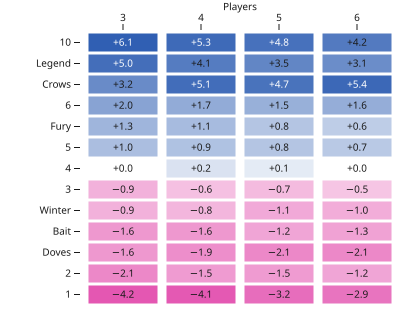
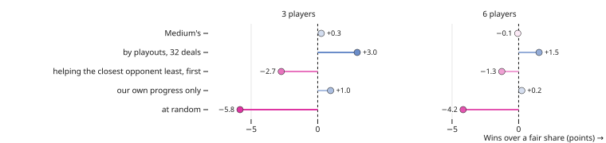

# Hilt

Hilt is a card game for 3 to 6 players from CMYK's Magenta line. Dominique Ehrhard designed
Hilt. It is a game of battles. Everyone is dealt 10 cards. In each battle you go around the
table playing cards into a row in front of you or passing until everyone has passed. Whoever has
the highest total strength wins a chip. Three chips of a color, or one of each color, win the
game. Nobody draws between battles: cards you spend winning one are gone until the round ends.
A round ends when only one player has cards left.

This repo is a simulator of the game. It plays millions of games by the rules. Those games
answer the questions that come up at the table: how much the Favor card is worth, which cards
matter, and above all when to fight for a chip and when to let it go.

The answers come from the model. They don't come from real tables. The model follows the How to
Play booklet. `CLAUDE.md` lists the readings the booklet leaves open. The model hasn't been
checked against real games.

The simulator and this analysis were written with Claude Opus 5.5 in Claude Code.

## A quick refresher

The deck is 96 cards: force cards worth 1 (15 of them), 2, 3, 4, 5, 6 and 10 (8 each), and fate
cards that change the battle:

- **Bait** (15): discard it to take a force card from your row back into your hand.
- **Fury** (6): your force cards count double. Each player can play one Fury a battle.
- **Legend** (3): 10 strength that nothing changes.
- **Winter** (3): every force card in the battle is worth 1. Only one Winter can be played a
  battle.
- **Crows** (3): the battle ends at once. Whoever leads wins.
- **Doves** (3): the battle ends at once with no winner. The chip and the Favor stay where they
  are.

The Favor card goes to whoever won the last battle. Its holder picks which color of chip the next
battle is over, has 1 strength in their row before anyone plays, and acts last. Ties go to fewer
cards played, then the highest card, then clockwise from the Favor holder. Passing is for the
rest of the battle. When a battle leaves only one player with cards, that player discards them.
Then everyone is dealt 10 again plus one card per chip they hold.

## Reading the numbers

Almost every number here is a win rate: the share of games one player wins, out of tens of
thousands played from different deals. Most tables seat one player of some kind at a table of
default players. The tables rotate that player through every seat. That evens out seat order.

- **A fair share** is what a player wins when nobody has an edge. That's 1 in however many are
  at the table: 33.3% at 3 players and 16.7% at 6. A column headed "3 players (fair 33.3%)" says
  which share to compare with.
- **Points** are percentage points of win rate. A rule worth "+4 points" takes a player from
  33.3% to 37.3% of games. Points over a fair share are a win rate minus the fair share.
- **Fair shares** divide a win rate by a fair share instead. A player at 2.0 fair shares wins
  twice as often as an even player would: 66.7% at 3 players or 33.3% at 6. Fair shares compare
  player counts. The same points mean more at a bigger table.
- **A card's value** is in points too: how much more often a player wins with one more copy of it
  in their opening hand, in place of a random card, from the same deal played both ways.
- **Points a decision** (for the learned player) are the win chance one move adds over another at
  a single decision. They come from playing each move out to the end.
- **The noise** comes from playing a finite number of games. The noise is about ±0.5 points at
  40,000 games, ±0.3 at 100,000, and ±1.5 at 4,000. Differences smaller than that are a tie.

The charts are drawn from this README's own tables. After `pnpm install`, `node scripts/charts.ts`
redraws `charts/`.

## How the default player plays

Every table here is played by or against `defaultPolicy` in `src/game.ts`. `defaultPolicy` is a
list of rules tried in order. Each rule was found by playing out every legal move at the
default's decisions (`scripts/decisions.ts`). A rule was adopted when it beat the default head to
head (`scripts/variants.ts`):

1. Once everyone else has passed, Bait back the biggest force card that still leaves you ahead.
   Then pass to win. With others still in, Bait back the biggest that leaves you more than 4
   ahead.
2. Crows when you have a card of your own played and would still lead with Crows in your row.
   Crows counts as a card for the tie-break. Doves when you're behind and the chip would win you
   the game, or would win the leader the game with nobody else still in to stop them.
3. If you're ahead with nothing played and others still in, play a Fury, or else your strongest
   card. The Favor holder is ahead like this at first.
4. Ahead with something played and others still in, play a Fury, or else your weakest force
   card. Don't pass: passing is final. A pass leaves them to overtake with nobody to answer.
5. Don't open a battle while 2 or more others are still in: let them spend their cards. Not
   when the chip would win you the game, or anyone else with fewer than 3 others in. At 3
   players, deny a chip that would win the other player the game with your strongest card. Don't
   deny it with your cheapest. When the leader would win the game with this chip and fewer than
   3 others are in, take the lead with the cheapest card that does it. Don't open with a 1 that
   leaves them ahead.
6. Otherwise open with a 1 or a Fury. Those are the cheapest cards.
7. With nobody else left in, play your strongest card if your hand would overtake: nobody can
   answer. Rule 1 takes back what wasn't needed.
8. Behind with others still in, Bait back a 1: it keeps you in the battle for nothing. Or play
   a 1.
9. Behind, take the lead with the cheapest card that does it, however much the battle has cost
   you.
10. Behind with the chip that wins you the game, play your strongest card even if it doesn't take
    the lead.
11. Before giving up a battle, Bait back your biggest force card.

Rule 5's strongest card at 3 players came from the learned player too. The learned player plays
10s where the default waited or opened with a 1. The strongest card is worth +6.4 points against
the default and +3.5 against the league (40,000 games). Against the learned player, the strongest
card ties. At 4 to 6 players, the same move loses up to 3.5 against the league.

Taking the lead from a leader on game point started with a person's game. There, the person's
passes on a chip that won Bot 1 the game cost 54 and 66 points. That pointed at the situation, so
we looked at what the default did there. With fewer than 3 others in, it opened with a 1, and a 1
rarely takes the lead. Taking the lead instead wins 3.4, 3.9, 2.7 and 1.9 points more at 3–6
players against the previous default. Against the league it wins 1.9 more at 3 players and 0.3
to 0.4 more at 4–6 (40,000 games). It isn't a bet on weak players. It gains 1.8 to 2.5 points
against the learned player and 2.5 to 6.3 against playouts (4,000 games). Doing it with 3 or more
others in loses 0.4 to 3.6 points against the league at 4–6 players. Doing it only with 1 other in
gains at most a point (4,000 games).

Rule 9 used to give up once a battle had cost you 3 cards. A person exploited that limit. With
the default one on one, they stayed just ahead until it stopped with 6 cards still in hand. Then
they Baited back what they'd spent. Without the limit, the default wins 3.3, 2.6, 1.8 and 1.5
points more at 3–6 players against the previous default. It wins 1.7, 1.2, 0.9 and 0.6 more
against the league (40,000 games). Against the learned player it gains 0.1 to 1.0, and against
playouts it ties (4,000 games). A limit of 5 cards does as well as no limit.

Waiting or opening at random doesn't help. A rule that wins as a bet on the table invites a mix:
wait some of the time and open the rest, so no table can exploit you. Waiting 25%, 50% or 75% of
the time lost 1.6 to 7.3 points against the default and up to 3.6 against the league (4,000
games). Waiting every time stays.

Rule 4 came from the learned player (below). Rule 4 was the first rule that did. The learned
player's moves differ from the default's at 74% of its decisions at 3 players and 49% at 6. Most
of the differences are plays where the default passed. The largest group of those was ahead with
a card down and one other still in. There the default had no rule and passed. Playing the
weakest force card there wins 50.5%, 34.7%, 26.4% and 21.8% at 3–6 players against the previous
default (40,000 games). Against the league, the same play wins 6, 2, 1.4 and 0.8 points more than
the previous default. The strongest card does about as well against the default. Against the
league, the strongest card does a little worse. Playing only one on one gets most of the gain:
46.2% at 3 players. A 1 or a Fury instead gains under a point. Rule 4 holds up against strong
players too. With quick playouts in every other seat, the default wins 39.7% at 3 players and
17.9% at 6, against the previous default's 34.7% and 16.0% (6,000 games). At a table of round
9's learned players, the default wins 5.9%, 5.8%, 5.3% and 4.5% at 3–6 players, against 3.5%,
3.6%, 3.3% and 2.9% (10,000 games). Round 9 itself wins more against the new default: 67.0%,
53.1%, 47.4% and 42.7% at 3–6 players, against 41.1%, 43.3%, 37.1% and 32.0% before. Perhaps
default players that fight every lead out spend more of their cards on each other (untested).
The models still take the previous default's pick as one of their inputs. That's what they were
trained on.

The first default had only rules 2, 9 and 11. Against a field of later defaults, the first
default wins 12.4% at 3 players and 4.7% at 6. Each rule after that was the best answer to the
default before it. The rules don't settle. Once everyone waits, opening pays again. Once everyone
opens, waiting does. So from the fifth round on, rules were also judged against a league. The
league seats a default from every round in each other seat (`variants.ts --field league`). A
rule was kept only if it won there too. Bait back a 1 while ahead, for one, gains 4 to 7 points
against today's default. Against the league, the same rule loses a point.

### Against strong players

Each rule again, with playouts on 8 deals in every other seat (`variants.ts --field playouts`,
6,000 games). Playouts play every move out with the default playing on. Before rule 4, the
playouts beat the default. Now the default wins 51.9% at 3 players against them:

| without the rule | 3 players | 6 players |
| --- | --- | --- |
| no 1 once something's played | 53.4% | 18.2% |
| only overtake with a single card | 52.9% | 18.7% |
| press with the strongest card, not a Fury | 52.0% | 18.4% |
| today's default | 51.9% | 18.1% |
| deny every winning chip | 51.9% | 42.1% |
| no Bait back of a 1 while others are in | 51.7% | 19.4% |
| Crows while leading before it's played | 51.3% | 18.0% |
| open with a 1 or Fury with nobody else in | 51.1% | 17.8% |
| pass only at a single card's reach of the lead | 50.1% | 17.6% |
| no Bait back after winning | 49.7% | 18.1% |
| Crows whenever ahead | 49.6% | 17.5% |
| pass when ahead with an empty row | 47.5% | 16.0% |
| open with a 1 or Fury before waiting | 45.4% | 23.4% |
| pass when ahead with something played | 45.3% | 16.8% |
| open battles: don't wait | 44.7% | 28.9% |
| the first default | 34.6% | 26.0% |

Two rules are bets on how the others play. Leaving a chip that wins someone the game for the
others to deny is worth 0.8 to 4.4 points among default players at 4 to 6 players. Default
players deny it once fewer than 3 are left. Playouts expect the others to deny it. So among
playouts, nobody does. There, denying it yourself is worth 24 points at 6 players. Waiting to
open is the same bet at 6 players. Waiting pays when the others fight. Against players who wait
too, opening wins 10.8 points more. At 3 players, waiting pays 7.2 points against playouts too.
Rule 7, when it counted only your best 4, cost 2.7 points at 3 players here. The noise is ±1.2
points at 3 players and ±1 at 6. Yet dropping rule 7 loses 1.4 to 4.8 points among default
players and 3.9 to 7.5 against older defaults. Counting the whole hand gains 1.1 at 3 players.
Rule 8 is a bet too. Against playouts, playing no 1 once something's played gains 1.5 points at
3 players, and not Baiting back a 1 gains 1.2 at 6 (24,000 games, noise ±0.6). Rule 8 still
gains 3.5 to 7.5 points among default players and 2.5 to 6 against older defaults, so it stays.

The learned player Baits back its strongest force card when it's losing a battle. The default
plays a 1 there. Baiting back the strongest card is another bet: it wins 0.9 to 1.7 points
against older defaults. Against today's default, it loses 1.7 at 3 players and 0.7 at 4.

Who should deny is a free-rider problem. Which answer wins depends on the table. One player of
each kind against a table of the other (40,000 games):

| one player | table | 4 players | 5 players | 6 players |
| --- | --- | --- | --- | --- |
| leaves it to others (the default) | denies every winning chip | 24.3% | 25.3% | 24.2% |
| denies every winning chip | leaves it to others | 23.8% | 15.5% | 13.0% |
| leaves it to others | opens without waiting | 25.2% | 26.1% | 26.3% |
| denies every winning chip | opens without waiting | 33.2% | 34.1% | 35.6% |

Among players who deny, leaving it to them wins about a fair share at 4 players. The same choice
wins 1.5 fair shares at 6 players. Among players who open every battle without waiting, denying
yourself is better. At 3 players there's never anyone else to leave it to.

### Deals

The booklet allows deals. None are binding. The one this problem asks for is "you stop this
one": when the chip would win someone the game, one named player denies it. Everyone else stays
out. There are two ways to name them: the next player still in after the threat, or the one
still in who's furthest from winning. Both play the same. Against a table that has made the deal
(10,000 games, `variants.ts`, "deal:"):

| one player | 3 players | 4 players | 5 players | 6 players |
| --- | --- | --- | --- | --- |
| keeps the deal | 33.5% | 25.0% | 20.3% | 17.3% |
| makes the deal and never denies | 25.6% | 18.2% | 15.7% | 13.5% |
| never made it (the default) | 36.6% | 26.8% | 20.0% | 16.4% |
| keeps the deal at a table of defaults | 29.9% | 23.1% | 16.6% | 13.9% |

The deal keeps itself: once the others are staying out, the named player who doesn't deny hands
the threat the game. That player loses 4 to 8 points by not denying. So the deal isn't a
prisoner's dilemma. In a prisoner's dilemma, everyone is tempted to break their word. The deal is
a matter of agreeing who goes. Talk can settle exactly that, even in the last battle. But a
player who never made the deal does better at 3 and 4 players: 3.3 and 1.8 points over a fair
share. At 5 and 6 players, that player gets about a fair share. Making the deal alone at a table
that hasn't costs 2 to 3.5 points. Offer the deal when the others will take it. If they've made
it without you at 3 or 4 players, stay out of it. A looser deal only holds
off opening. The looser deal lets the others go on playing a battle they've already put cards
into. The looser deal plays exactly the same (tried with the next player denying): the deal's
cost is in who opens.

## Going first

The Favor starts in seat 1. Seat 1 acts last in the first battle. 100,000 default games
(`scripts/sim.ts`):

| players | seat 1 | seat 2 | seat 3 | seat 4 | seat 5 | seat 6 | battles | rounds |
| --- | --- | --- | --- | --- | --- | --- | --- | --- |
| 3 | 39.9% | 37.1% | 23.0% | | | | 7.5 | 2.4 |
| 4 | 27.5% | 32.5% | 25.0% | 14.9% | | | 8.4 | 2.1 |
| 5 | 25.0% | 27.7% | 19.0% | 17.6% | 10.7% | | 9.5 | 2.0 |
| 6 | 21.3% | 27.0% | 14.6% | 13.4% | 15.1% | 8.6% | 10.6 | 1.9 |

Seat 2 acts first in the first battle. The Favor's seat and seat 2 are best: 1.1 to 1.2 fair
shares at 3 players, and 1.3 to 1.6 at 6. The last seat is worst: 0.5 to 0.7 of a fair share.
Before the default held its lead (rule 4), seat 2 was best at 3 players too: 41.5% to the Favor
seat's 34.5%. The first default fought every battle. Under the first default, the Favor seat won
40.5% at 3 players and 29.3% at 6. Seat 2 got the worst share but one. So who the first battle
favors depends on how people play it. Only 14% of games at 3 players end in the first round. At
6 players, 25% do (20,000 games).

## What each card is worth

The points one more copy in an opening hand adds, in place of a random card, from the same deal
played both ways (`scripts/cards.ts`, 200,000 deals each):

| card | 3 players | 4 players | 5 players | 6 players |
| --- | --- | --- | --- | --- |
| 10 | 6.1 | 5.3 | 4.8 | 4.2 |
| Legend | 5.0 | 4.1 | 3.5 | 3.1 |
| Crows | 3.2 | 5.1 | 4.7 | 5.4 |
| 6 | 2.0 | 1.7 | 1.5 | 1.6 |
| Fury | 1.3 | 1.1 | 0.8 | 0.6 |
| 5 | 1.0 | 0.9 | 0.8 | 0.7 |
| 4 | −0.0 | 0.2 | 0.1 | 0.0 |
| 3 | −0.9 | −0.6 | −0.7 | −0.5 |
| Winter | −0.9 | −0.8 | −1.1 | −1.0 |
| Bait | −1.6 | −1.6 | −1.2 | −1.3 |
| Doves | −1.6 | −1.9 | −2.1 | −2.1 |
| 2 | −2.1 | −1.5 | −1.5 | −1.2 |
| 1 | −4.2 | −4.1 | −3.2 | −2.9 |

These are against a random card. A card worth nothing is about average. What a card is worth
depends on how it's played. The first default fought every battle and played Crows whenever it
led. Against the first default, a 10 or a Legend was worth 8 to 12 points. Crows was worth −6.5
to −10. The default now holds a lead by playing its weakest force card. Played that way, force
cards are worth about their value: a 10 the most and a 1 the least. Crows is worth about as much
as a 10 at 4 and 5 players. Crows is worth more than a 10 at 6. Before the default held its lead,
a 1 was worth more than a 6 as a free way to stay in. Fury and Crows were worth the most then.

## Playing the fate cards

Most of what the rules say is about cards as a budget. The 1s, Furies and Baits are cheap ways to
stay in a battle without spending anything that matters. Passing is final. So when you could
pass, you play one of those instead. That holds when you're ahead, too: a pass with others still
in leaves them free to overtake you. So keep adding your weakest card until they give up. The
10s and Legends decide battles. Spend them only when nobody can answer. Take them back with Bait
when you can.

The table above says what a card is worth to be dealt. This one says what it's worth to play
well: the default against the same player that plays as if the card weren't in its hand
(`variants.ts`, "never play", 10,000 games), in points:

| playing it as the default does | against the default, 3 / 4 / 5 / 6 players | against the league |
| --- | --- | --- |
| Fury | 13.9 / 5.2 / 5.0 / 5.0 | 14.7 / 7.2 / 7.0 / 5.8 |
| Bait | 3.5 / 2.5 / 3.3 / 3.4 | 12.2 / 9.1 / 9.4 / 8.2 |
| Legend | 8.2 / 4.8 / 4.5 / 3.6 | 8.2 / 4.7 / 3.7 / 3.3 |
| Crows | 6.4 / 6.9 / 5.8 / 5.0 | 6.4 / 4.5 / 3.6 / 3.2 |
| Winter | 2.8 / 1.3 / 1.1 / 1.4 | 3.3 / 1.8 / 1.7 / 1.1 |
| Doves | 2.8 / 0.1 / −0.2 / 0.2 | 1.5 / 0.6 / 0.0 / 0.0 |

**Fury** is the card to play first. Fury doubles every force card in your row, including the ones
played after it. As the Favor holder with nothing down, lead with a Fury before your strongest
card (rule 3, 4 to 5 points over the strongest card alone). When you open behind, a Fury is as
cheap as a 1 (rule 6). Once you lead with something down and others still in, play it before
your weakest card (rule 4). Under Winter it still makes your force cards 2 each. At 3 players,
playing Fury well is worth more than playing any other card: 13.9 points. At 4 and 5 players,
Crows is worth more. At 6, Fury and Crows tie.

**Bait** is a poor card to be dealt: worse than a random one. Bait is also an essential card to
use. Bait can only take back a force card from your own row. So Bait is never a way into a
battle. Bait is only a way to spend less in one. Bait has four uses. Once everyone else has
passed, Bait back the biggest card that still leaves you ahead (rule 1, 2 to 4 points). That
brings home a 10 that won the battle. Leading by more than 4 with others still in, Bait back the
biggest card that keeps that lead (rule 1). While behind with others still in, Bait back a 1 to
stay in without spending anything (rule 8, 4.5 to 7 points). Before giving up a battle, Bait back
your biggest card (rule 11). Bait is worth 2.4 to 3.6 times as much against the league as against
today's default.

**Legend** is a 10 that Winter can't touch and Fury doesn't double. Spend it like a 10: as the
Favor holder's strong opener, to finish a battle nobody else is still in (rule 7), or when the chip
decides the game. In a Winter battle it's the strongest card at the table by far.

**Crows** wins the battle on the spot for whoever leads. So play Crows only when that's you.
Play it only with a card of your own down. The Favor's 1 strength alone isn't enough (rule 2, 2
to 5 points over Crows whenever ahead). Crows also counts as a card in your row. Ties go to fewer
cards, so Crows can hand away a tie you were winning. Before you play it, count it and check you
still lead. The default used to check only before playing it. Then 27% of its Crows plays lost
the battle (8,953 of 33,171, in 20,000 games). Checking after gains 2.1, 1.8, 1.3 and 1.2 points
at 3–6 players against the previous default (40,000 games). Against the league it gains 1.4, 1.3,
0.9 and 0.7. Against playouts it ties (6,000 games). Crows is worth 3.2 points to be dealt at 3
players and 4.7 to 5.4 at 4 to 6.

**Winter** turns every force card into a 1 for the rest of the battle. So Winter helps whoever
has more cards down, or a Legend. The default plays Winter only when Winter takes the lead
outright. The default counts Winter as cheap as a 3. That's worth a point or two. A Winter in
hand is worth a little less than a random card.

**Doves** ends the battle with no winner. Everything played in it is gone. The chip is fought
over again next battle. The Favor stays where it is. Doves is a poor card to be dealt: about 2
points below a random one. The default used to play Doves whenever someone else led with a chip
that would win them the game. That was worth nothing measurable. So what is it for? Here is
Doves against the move you'd make without it, at every chance to play it on someone else's lead
in 16,000 default games. Each was played out on 64 deals (`scripts/fates.ts` as of 75b7650):

| when you could play Doves | how often, a game | Doves gains, points | Doves better |
| --- | --- | --- | --- |
| the chip would win you the game | 0.44 | 5.4 | 63% |
| …and it's one on one | 0.09 | 8.0 to 11.0 | 66 to 70% |
| you hold the Favor | 0.80 | 4.2 | 60% |
| the others have more than 4 cards down | 0.47 | 3.4 | 58% |
| the leader has put down a quarter to half their hand | 0.56 | 3.4 | 56% |
| the leader has 3 to 5 cards left | 0.69 | 2.7 | 46% |
| the others have nothing down yet | 1.00 | −0.6 | 19% |
| the chip would win the leader the game | 0.39 | −0.8 | 24% |
| nobody else is still in | 0.17 | −8.0 | 37% |

Doves is a second chance at your own winning chip. Say you're losing the battle for the chip
that would end the game in your favor. Void it with Doves. The same chip is up again next
battle. The Favor's holder is unchanged. That's rule 2 now. Rule 2 also voids someone else's
winning chip once nobody else is left to stop it. Together they gain +2.6 points at 3 players
against the default and +0.3 at 4 to 6 (40,000 games). They do a little better against the
league and the learned player too. Doves also pays to keep the Favor. Doves pays to wipe out a
battle the others have poured cards into. That stops paying once the leader is nearly out of
cards. Adding either to the rule gains nothing more. Likely a Doves spent there isn't in your
hand when your own winning chip comes up (untested). Don't play Doves on someone else's winning
chip while others are still in. Don't play it when nobody else is in, either. There you can
overtake with nobody to answer.

The same playouts ran for every fate card at every chance to play it in 16,000 default games
(`scripts/fates.ts --card <fate>`). The chances are split by whether the default already plays
the card there. Where it doesn't, the gain over its move:

| card | chances a game the default passes up | gain there, points | where it gains most |
| --- | --- | --- | --- |
| Bait | 8.2 | 2.2 | you lead by more than 10: 3.8 |
| Legend | 4.1 | 0.8 | Winter's out: 3.8 |
| Fury | 5.6 | −1.1 | you lead by 5 to 10: 5.8; by more: 8.2 |
| Doves | 5.0 | −3.1 | you're more than 10 behind: 1.8 |
| Winter | 5.8 | −2.7 | nowhere |
| Crows | 4.1 | −16.4 | nowhere |

For Winter and Doves, every other chance loses. Every other chance to play Crows loses too. This
table can't show the Crows plays the default should have skipped: rule 2 now skips them. Bait
and Fury while leading became rules 1 and 4. Together they gain +3.4, +1.0, +1.3 and +1.1 points at 3–6 players
against the default. Against the league they gain +2.4, +0.9, +0.6 and +0.7 (40,000 games).
They tie with the learned player. The Fury alone gains only at 3 players (+2.7). Legend's gains
are spread thin. There's nothing yet to make a rule of.

## A learned player

The rules above top out well short of playouts. Playouts play every legal move out to the end
and make the best one. But playouts cost thousands of games a decision. So a player learned to
predict what playouts would say. `scripts/dataset.ts` plays default games. At every decision of
one player, the script plays every legal move out to the end on 32 shared deals. That's about
250,000 decisions at each player count, in 10 minutes. `scripts/learn.py` fits gradient-boosted
trees (LightGBM, 1,000 trees) to predict each move's value from 40 numbers about the board and
19 about the move. `src/learned.ts` plays the move the trees rank first. On held-out games, this
first model's pick gains 3.1 to 3.6 points of win chance a decision over the default's:

| learned player | 3 players | 4 players | 5 players | 6 players |
| --- | --- | --- | --- | --- |
| against the default | 74.7% | 61.4% | 54.3% | 50.3% |
| against the league of defaults | 73.0% | 58.1% | 49.3% | 43.3% |
| against playouts on 8 deals | 53.6% | | | 27.9% |
| the default, against learned players | 8.8% | 6.7% | 7.9% | 8.8% |

The learned player plays as well as playouts on 128 deals. The learned player costs a tiny
fraction as much. The learned player isn't just exploiting the default: it holds up against
every earlier default and against playouts.

A learned player reaches boards the default never does. So each round after the first trains on
games the last round's learned player played (`dataset.ts --play`). Those games are labeled the
same way, with default players inside the playouts. Each round adds them to the earlier rounds'
data. Each model is then played against the default and against tables of the earlier models'
players (20,000 games each):

| model | against the default, 3 / 4 / 5 / 6 players | against round 0 | against rounds 0–1 |
| --- | --- | --- | --- |
| round 0: default games | 74.7 / 61.4 / 54.3 / 50.3 | 33.3 / 24.7 / 20.3 / 16.9 | |
| rounds 0–1: and the learned player's | 77.0 / 61.9 / 54.8 / 50.6 | 37.5 / 27.6 / 24.6 / 22.2 | 33.2 / 24.9 / 20.2 / 17.0 |
| rounds 0–2 | 77.5 / 62.0 / 55.6 / 51.6 | | 34.4 / 25.4 / 20.3 / 16.9 |

Round 1 gains 3 to 5 points against round 0's players. The gain comes from seeing the boards a
learned player reaches. Round 2 ties round 1: the labels still ask which move is best if default
players play on. The loop converges on the best answer to them.

So round 3 asks which move is best if learned players play on. Rounds 0–1's learned player plays
the games. A 200-tree version of it plays inside the playouts (`dataset.ts --rollout`). The
playouts use 16 deals instead of 32. That costs 25 times as much a decision. So round 3 is 3,000
games a player count: about 55,000 decisions, in 33 minutes. Against 20,000 games each:

| model | against the default | against rounds 0–1 | against round 3 |
| --- | --- | --- | --- |
| rounds 0–1 | 77.0 / 61.9 / 54.8 / 50.6 | 33.2 / 24.9 / 20.2 / 17.0 | 20.6 / 20.2 / 18.4 / 16.9 |
| round 3 | 58.6 / 48.1 / 41.8 / 35.3 | 53.6 / 42.3 / 33.8 / 28.5 | 33.2 / 24.6 / 20.0 / 16.7 |
| rounds 0, 1 and 3 together | 75.6 / 60.8 / 53.3 / 47.6 | 34.5 / 25.6 / 19.4 / 16.6 | 21.4 / 20.0 / 18.1 / 15.4 |

At 3 to 6 players. Round 3's player beats a table of rounds 0–1's by 12 to 20 points. Round 3's
player wins less against the default. What the labels assume about the others decides whom the
player beats. The same was true of the rules. Mixed in with the default-labeled rounds, round
3's labels wash out.

Round 4 does it again with round 3's player in the games and the playouts (`dataset/model-r3s`):

| model | against the default | against rounds 0–1 | against round 3 |
| --- | --- | --- | --- |
| round 4's games alone | 49.8 / 51.8 / 43.8 / 38.8 | 44.5 / 30.1 / 19.9 / 14.6 | 43.5 / 41.2 / 39.8 / 36.4 |
| rounds 3 and 4 together | 56.3 / 53.9 / 48.2 / 44.5 | 53.9 / 40.9 / 31.7 / 25.4 | 44.6 / 41.3 / 39.6 / 36.7 |

Rounds 3 and 4 together beat round 3's players by 11 to 20 points. They keep round 3's edge over
rounds 0–1's. They do better against the default at 4 to 6 players. So from here on, each
round's model is fit to every round's games from round 3 on. "Round 4" means that model. Round 4
holds up elsewhere too:

| round 4 | 3 players | 4 players | 5 players | 6 players |
| --- | --- | --- | --- | --- |
| against the league of defaults | 62.6% | 53.0% | 44.6% | 38.3% |
| against playouts on 8 deals | 59.6% | | | 34.3% |
| rounds 0–1, against them | 11.3% | 11.2% | 7.2% | 5.2% |
| the default, against them | 2.8% | 4.6% | 4.5% | 3.8% |

Each round after that does the same again from the model before it. Each round adds its games to
the data so far. One player of each model at a table of the model before it (20,000 games each):

| round | at a table of | 3 players | 4 players | 5 players | 6 players |
| --- | --- | --- | --- | --- | --- |
| 3 | rounds 0–1 | 53.6% | 42.3% | 33.8% | 28.5% |
| 4 | round 3 | 44.6% | 41.3% | 39.6% | 36.7% |
| 5 | round 4 | 39.3% | 29.5% | 23.7% | 20.3% |
| 6 | round 5 | 37.1% | 26.7% | 22.1% | 18.7% |
| 7 | round 6 | 34.6% | 27.1% | 22.3% | 18.6% |
| 8 | round 7 | 34.4% | 26.7% | 21.3% | 17.7% |
| 9 | round 8 | 33.4% | 25.9% | 20.5% | 17.3% |
| 10 | round 9 | 34.0% | 25.3% | 20.5% | 17.0% |

And each against the default:

| round, against the default | 3 players | 4 players | 5 players | 6 players |
| --- | --- | --- | --- | --- |
| 3 | 58.6% | 48.1% | 41.8% | 35.3% |
| 4 | 56.3% | 53.9% | 48.2% | 44.5% |
| 5 | 49.7% | 51.2% | 46.8% | 42.6% |
| 6 | 40.7% | 46.5% | 41.6% | 36.2% |
| 7 | 42.2% | 45.9% | 40.5% | 34.1% |
| 8 | 38.7% | 44.5% | 37.9% | 33.0% |
| 9 | 41.1% | 43.3% | 37.1% | 32.0% |
| 10 | 43.0% | 43.3% | 36.8% | 31.6% |

Every round still beats the one before. Each beats it by less: round 7 by 1.3 to 2.3 points over
a fair share, against round 6's 1.7 to 3.8. Each also beats the older models by more than the
one before it did: round 7 beat a table of round 5's 38.8%, 29.0%, 24.6% and 20.0%. Round 6
managed 37.1%, 26.7%, 22.1% and 18.7%. Against the default they've won less since round 4. They
learn to beat learned players instead. Round 7 about holds there.

Round 8 gains 1.0 to 1.7 points over round 7. That's less again. Round 8 beats every older model
by more than round 7 did: a table of round 6 wins it 35.4%, 29.0%, 23.4% and 19.6%, round 5
38.7%, 30.7%, 25.1% and 21.1%, and round 4 45.6%, 33.1%, 27.5% and 24.3%. Against the default
round 8 loses another 1 to 3.5 points.

Round 9 gains 0.5 to 0.9 points over round 8 at 4 to 6 players. Round 9 ties round 8 at 3
(33.4%). Against older models, round 9 does about as well as round 8 did: within half a point
either way. So the rounds are levelling off. Against the default, round 9 wins 2.4 points more at
3 players. Round 9 wins about a point less at 4 to 6. Hard now plays a model fit to round 9's
data and the mixed rounds together (see "Knowing the table").

Round 10 played twice the games (6,000 a player count). Round 10 gains only 0.3 to 0.7 points
over round 9. That's within the noise. So round 10 wasn't adopted. Against older models, round
10 does less than a point better than round 9 did: a table of round 8 wins it 34.7%, 26.2%, 20.6%
and 17.4%. More games of the same kind don't restart the gains.

## Which chip to fight over

The Favor holder picks the chip for the next battle. The default picks the one that leaves it
fewest chips from winning, then the one that helps the closest opponent least (`pickColor`).
Against the default (`variants.ts`, 40,000 games):

| chip | 3 players | 4 players | 5 players | 6 players |
| --- | --- | --- | --- | --- |
| the default's | 33.4% | 24.6% | 19.9% | 16.9% |
| by playouts, 32 deals | 36.1% | 26.0% | 21.5% | 18.5% |
| helping the closest opponent least, first | 31.6% | 23.7% | 19.0% | 16.1% |
| our own progress only | 33.3% | 23.5% | 19.0% | 15.7% |
| at random | 27.2% | 18.8% | 14.8% | 12.4% |

The pick is worth 4.5 to 6 points. The default's rule gets most of that: playing each chip out
gains 1.4 to 2.7 points more. Before the default held its lead, playing each chip out gained
under half a point. Your own progress comes first. Ignoring everyone else's costs up to 1.2
points.

## Discarding a hand with no force cards

A player who passes with no force cards in hand may show it and discard it. Nobody draws until
only one player has cards left. So emptying your hand brings the next deal closer. At the next
deal you get 10 fresh cards and one more a chip. The default always does. Against the default
(`variants.ts`, 40,000 games):

| on passing with no force cards | 3 players | 4 players | 5 players | 6 players |
| --- | --- | --- | --- | --- |
| discard (the default) | 33.4% | 24.6% | 19.9% | 16.9% |
| discard or keep, by playouts on 32 deals | 34.0% | 25.2% | 20.4% | 17.3% |
| keep the hand | 27.7% | 21.3% | 17.8% | 15.3% |

Always discarding is within 0.6 points of playing each choice out: the fate cards left in such a
hand are worth less than getting to the next deal sooner. Keeping them costs 5.7 points at 3
players and 1.6 at 6.

## Strategies

One player of each against the default in every other seat (`scripts/strategies.ts`, 100,000
games; playouts 4,000):

| strategy | 3 players | 4 players | 5 players | 6 players |
| --- | --- | --- | --- | --- |
| default | 33.5% | 24.8% | 19.9% | 16.5% |
| learned, rounds 0–1 | 77.0% | 61.9% | 54.8% | 50.6% |
| learned, round 5 | 49.7% | 51.2% | 46.8% | 42.6% |
| learned, Hard | 65.3% | 53.6% | 46.6% | 41.9% |
| playouts, 128 deals | 70.0% | 59.3% | 51.2% | 46.8% |
| playouts, 32 deals | 56.7% | 44.4% | 34.3% | 31.6% |
| playouts, 8 deals | 26.9% | 20.2% | 17.8% | 16.1% |
| spender: chase every battle | 9.3% | 2.7% | 2.3% | 1.8% |
| no Bait | 9.3% | 2.5% | 2.1% | 1.8% |
| random | 1.4% | 1.0% | 0.8% | 0.6% |
| passive: never play | 0.0% | 0.0% | 0.0% | 0.0% |

Playouts play out every legal move to the end of the game on deals of the cards they can't see.
The default plays on in those playouts. Playouts make the move that wins most. Against the first
default, 32 deals won 84% at 3 players and 76% at 6. Each round of rules took some of that away.
Rule 4 took 3.5 to 5.5 points more. Today, 8-deal playouts win less than a fair share. More
deals still help a lot. So there's plenty more to how Hilt should be played than the default's
rules. Rounds 0–1 and 5 were played against the default before rule 4. Spending to win every
battle is ruinous. So is never taking a card back with
Bait. The learned players are in "A learned player". Rounds 0–1 learned to beat default players.
Round 5 learned to beat learned ones. At a table of each other, round 5 wins. The later rounds
are in "A learned player"'s tables.

Playouts can also race. Racing plays the moves out 8 deals at a time on the same deals. It drops
a move once that move is 2 standard errors behind the leader. Racing stops when each move left
has had its full number of deals. That spends the deals on the moves still in contention.
Playouts can also play out only the 3 moves the learned model ranks highest. Against the default
(4,000 games):

| playouts | 3 players | 4 players | 5 players | 6 players |
| --- | --- | --- | --- | --- |
| racing, up to 128 deals | 68.9% | 59.4% | 49.8% | 47.0% |
| racing, the model's top 3 moves | 69.2% | 59.9% | 51.9% | 46.3% |
| racing, up to 512 deals | 72.8% | 63.8% | 56.1% | 51.6% |
| racing, up to 512 deals, the model's top 3 moves | 72.1% | 63.5% | 57.8% | 51.5% |

Racing on 128 deals costs 0.6 times as much as 128 full deals. Racing ties full playouts on 128
deals: it wins 1.4 points less to 0.2 more (±1.5 is noise here). Pruning to the model's top 3
also ties: it wins 0.7 points less to 2.1 more.

### Knowing the table

Playouts guess how the others will play on. So far they've guessed the default. How much is
a better guess worth? At a table of past defaults (each other seat one from every round so far,
at random), playouts guessing three ways (`variants.ts --field league`, 4,000 games):

| playouts, guessing the others play | 3 players | 4 players | 5 players | 6 players |
| --- | --- | --- | --- | --- |
| 32 deals, like today's default | 44.0% | 33.5% | 25.4% | 20.4% |
| 32 deals, like a past default at random | 55.9% | 44.3% | 35.7% | 32.6% |
| 32 deals, like the past default actually in each seat | 72.6% | 60.8% | 54.4% | 50.5% |
| 8 deals, like today's default | 21.8% | 18.0% | 14.9% | 11.7% |
| 8 deals, like a past default at random | 33.2% | 23.9% | 18.1% | 16.1% |
| 8 deals, like the past default actually in each seat | 44.5% | 39.0% | 32.4% | 29.9% |
| today's default, for comparison | 52.1% | 34.3% | 27.8% | 22.9% |

Knowing how each player plays is worth 27 to 30 points at 32 deals. That's more than quadrupling
the deals. About 40% of it is knowing what kinds of players are at the table (10 to 12 points).
The rest is knowing who's who (17 to 19). The "actually in each seat" rows are an upper bound: a
real player has to work out who's who from a few battles' play. The defaults differ most
in exactly what you can see (who waits, who opens with a 1, who chases every battle). For
people: watch who passes early and who spends. Answer those players. Don't answer an imagined
opponent who plays like you. Every learned player so far was trained at tables of itself. So
none of them uses this room.

So one round (`o1`) trained at mixed tables instead. Round 9's player sat in one seat. Each other
seat was a past default or, a third of the time, round 9's player again. Every move's playouts
played each seat on as it really plays (`round.sh` with `MIXED=1`, 4,000 games a player count).
The model also saw what each other player had shown so far this game: how often they waited,
opened and with what, held a lead, chased past 3 cards, and gave up (since removed).
Then the same data fit without those (20,000 games each):

| model | against the league | against the default | at a table of round 9 |
| --- | --- | --- | --- |
| round 9 | 46.0 / 44.6 / 38.1 / 32.3 | 41.1 / 43.3 / 37.1 / 32.0 | a fair share |
| `o1`, mixed tables | 75.3 / 66.5 / 58.6 / 51.3 | 61.9 / 50.9 / 40.9 / 33.4 | 19.8 / 11.3 / 8.6 / 7.0 |
| `o1` without what the others have shown | 74.0 / 66.5 / 59.8 / 52.8 | 61.1 / 50.4 / 40.8 / 33.9 | |

At 3 / 4 / 5 / 6 players. Training at the league's tables gains 19 to 29 points against the
league. That's as much as playouts that know who sits where. Against the default it gains 1 to
21. Seeing what each player has shown adds nothing. The trees split on it for 10% of their gain.
Those splits are spread thin. The trees play the same without it. Without it, the model already
wins about as much as the playouts that know who sits where. So the part that knowing who's who
seemed to add above was the guessing playouts' weakness. That part wasn't room to read players.
Learning what the table is made of is enough. And the gain is all against the kinds `o1` trained
on: at a table of round 9's players, `o1` wins 7 to 20%. Round 9 wins a fair share there. `o1`
saw round 9's players only a third of the time. What a model learns is how to beat the players
it practiced against. A model learns nothing about players it didn't.

A second mixed round (`o2`) put round 9's player in half the other seats instead of a third. The
model was fit to `o1` and `o2` together. It barely moved: 23.5 / 13.3 / 9.8 / 8.4 at a table of
round 9's players, 72.0 / 65.7 / 59.4 / 53.0 against the league. So the mix of seats wasn't what
was missing. What was missing was labels from tables of round 9's players. Rounds 3 to 9 have
those labels: 1.6 million decisions at learned tables. `o1` and `o2` are 0.6 million.

Fitting them together means pooling them. Every move from every round goes into one training
set. Each move is labeled with its playout win rate, and the trees learn to predict it. Nothing
weights one round over another. The two kinds of label can disagree about the same board and
move. A round 9 label assumes the others play like round 9. A mixed label assumes they're league
defaults. Where the board can't tell those tables apart, the trees land between the two labels,
weighted by how often each comes up. That's the hedge. Fit to all of it together:

| model | at a table of round 9 | against the league | against the default |
| --- | --- | --- | --- |
| round 9 | a fair share | 46.0 / 44.6 / 38.1 / 32.3 | 41.1 / 43.3 / 37.1 / 32.0 |
| rounds 3–9, `o1` and `o2` | 32.9 / 22.2 / 18.0 / 15.8 | 69.5 / 56.2 / 50.3 / 44.8 | 74.5 / 55.7 / 49.9 / 44.9 |

The combined model gives up 0.4 to 2.8 points at a table of round 9's players. It gains 12 to 24
against the league and 12 to 33 against the default. Against a table it doesn't know, it's the
safer player.

A third mixed round (`o3`, 2026-11-21) played against today's league. Today's league now ends
with today's default. Round 9's player sat in half the other seats. Alone, `o3` wins 0.6 to 1.6
points more than `o2` at a table of round 9's players. It wins 1.1 to 4.1 more against today's
default. It ties `o2` against the league. Fit with everything else, against today's default and
league (20,000 games each):

| model | at a table of round 9 | against the league | against the default |
| --- | --- | --- | --- |
| rounds 3–9, `o1` and `o2` | 32.9 / 22.2 / 18.0 / 15.8 | 67.9 / 55.7 / 49.9 / 44.1 | 64.4 / 53.4 / 47.2 / 42.4 |
| rounds 3–9, `o1` to `o3` | 32.8 / 22.3 / 17.3 / 15.4 | 68.3 / 57.2 / 51.4 / 46.0 | 64.6 / 54.0 / 47.8 / 43.0 |

It ties at a table of round 9's players and against the default. It gains 1.5 to 1.9 points
against the league at 4 to 6 players. Hard plays it.

Against the default with its Crows check (2026-11-23), Hard wins 65.0%, 53.3%, 46.6% and 42.2% at
3–6 players. Against the league it wins 68.0%, 56.6%, 51.4% and 45.8% (20,000 games).

Hard leaves a rival's game point for others to stop. In a game against two Hards and Medium, both
Hards passed with full hands while a person won on game point. Medium was left to stop the person
alone. Making Hard stop it itself loses, though. Hard plays Medium's `rival` rule first:
take the lead with the cheapest card when fewer than 3 others are in. That costs 2.1 points at a
table of two Hards and Medium, and 0.2 to 0.8 against the league. Doing it with any number of
others in costs 5.6 and up to 8.7 (4,000 games). At those tables, someone else usually does stop
the rival. Hard's free-riding wins more than it loses: it wins 29.3% at a table of two Hards and
Medium. Medium wins 13.0% there (20,000 games). Once nobody else is left in, Hard
doesn't free-ride. Making it take the lead there instead of passing wins exactly as many games
as Hard does on its own, at every table and player count (52,000 games).

## Rule readings

The booklet leaves one thing open that a flag in `Rules` reads either way: whether a Favor holder
with no cards left still has the Favor's 1 strength. It comes up in 4% of battles at 3 players
and 12% at 6. Either reading gives the same wins by seat, within half a point. Either reading
gives the same game length, within a tenth of a battle (`scripts/rules.ts`, 100,000 default
games each). The simulator reads it as yes.
